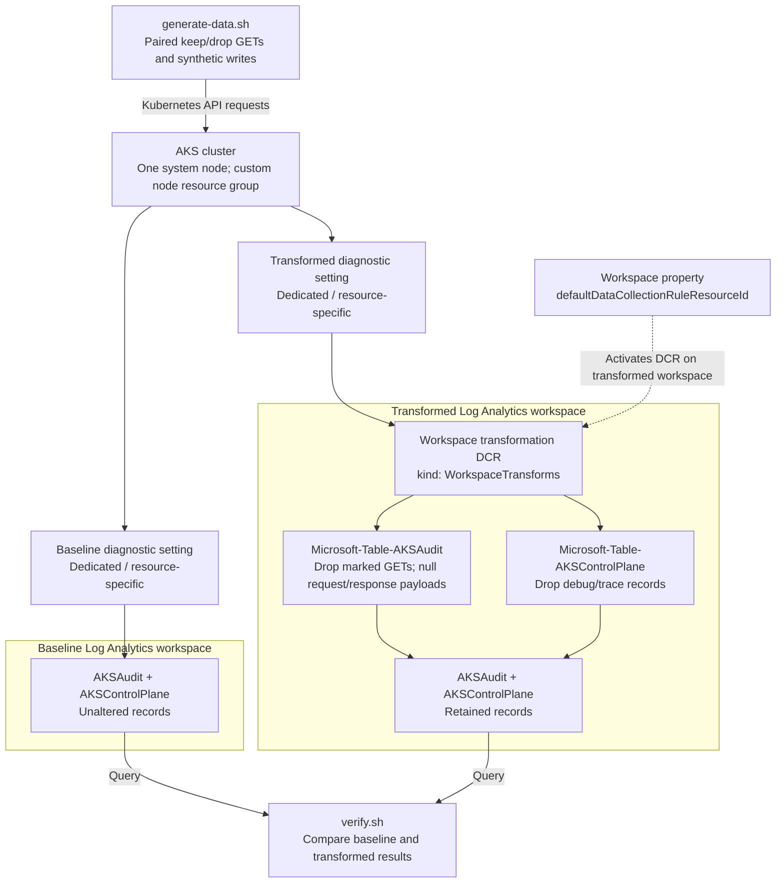

# AKS Control Plane Logs with DCR Transformations

Filter and redact AKS control plane logs at ingestion using an Azure Monitor workspace transformation DCR.

## What this demo proves

Deploy a small AKS cluster and send the **same diagnostic categories to two
dedicated Log Analytics workspaces**. Keep one workspace unchanged as a baseline;
apply ingestion-time transformations to the other. Generate synthetic Kubernetes
API activity and compare the results with automated assertions.

This is a **logs** demo, not the managed Prometheus control plane **metrics**
feature. No Container Insights agent, Azure Monitor workspace, data collection
endpoint (DCE), or Logs Ingestion API is needed.

> **Cost and security:** This creates real, billable Azure infrastructure. Two
> workspaces intentionally duplicate ingestion for comparison. The baseline
> retains original audit payloads; use only synthetic, non-sensitive data and a
> disposable subscription/resource group. Do not run this against production
> clusters or attach the DCR to an existing shared workspace.

## Architecture and resources



Terraform creates:

| Resource | Purpose |
|---|---|
| Dedicated resource group | Owns the demo resources |
| AKS + managed node resource group | Generates API audit and component logs |
| Two Log Analytics workspaces | Raw baseline and transformed comparison, Analytics plan, 30-day retention |
| Built-in table definitions in each workspace | Prepares `AKSAudit` and `AKSControlPlane` through the Tables API |
| One workspace transformation DCR | One data flow per transformed table |
| Workspace property update | Links only the transformed workspace to the DCR |
| Two AKS diagnostic settings | Route identical categories to each workspace |

The enabled categories are `kube-audit`, `kube-apiserver`,
`kube-controller-manager`, and `kube-scheduler`. Resource-specific mode
(`log_analytics_destination_type = "Dedicated"`) routes these to `AKSAudit` and
`AKSControlPlane`, not `AzureDiagnostics`.

`kube-audit-admin` / `AKSAuditAdmin` is deliberately **not** enabled: it excludes
read-only operations and would not demonstrate the selected GET filtering test.
Enabling both audit categories also duplicates many write events.

### Why the workspace link matters

A workspace transformation DCR is not an AKS agent-collection DCR. Attaching a
`dataCollectionRuleAssociation` to AKS or to the workspace is not the activation
mechanism. Azure uses the workspace property
`properties.defaultDataCollectionRuleResourceId`.

Terraform prepares the tables, creates the DCR with one Log Analytics destination,
and patches that workspace property **before** enabling diagnostics. AzAPI owns
the post-creation link; AzureRM ignores `data_collection_rule_id` to prevent
competing ownership and a workspace/DCR dependency cycle. All resources share a
region. The baseline workspace has no transformation DCR.
An explicit destroy-time workspace PATCH clears the link before Terraform removes
the DCR; deleting an AzAPI update resource alone does not revert that property.
Table preparation uses apply-time PUT actions, not table resources with a DELETE
lifecycle: built-in tables cannot be individually deleted. Destroying the
workspaces removes their data.

## Transformation policies

The deployable KQL is in [`transforms/`](transforms/), loaded directly by Terraform.
It uses documented table columns, not generic `AzureDiagnostics` fields.

| Table | Transformation | Intended result |
|---|---|---|
| `AKSAudit` | Drop GET requests whose URI starts with `/api/v1/namespaces/aks-dcr-demo/configmaps/dcr-drop-` | A precise, reproducible noise-filter example; preserve other reads and all writes |
| `AKSAudit` | Replace `RequestObject` and `ResponseObject` with dynamic nulls | Remove request/response bodies while retaining audit metadata and column types |
| `AKSControlPlane` | Exclude `Level` values `debug` and `trace`, case-insensitively | Preserve other levels, including empty or unrecognized strings |

Payload removal affects **all audit events in the transformed workspace**, not
just the scenario namespace. This is a teaching policy, not a complete
sanitization or audit-retention policy: identities, URIs, annotations, messages,
and other fields can still contain sensitive information.

Transforms operate on **newly ingested records only**. Discarded records and
removed fields cannot be recovered from the transformed workspace. Existing
records are not rewritten. A workspace has one workspace transformation DCR,
potentially containing multiple table flows; do not overwrite an existing DCR
when adapting this demo. Sources that already use their own DCR are not handled
by this workspace transformation path.

## Prerequisites

- Azure subscription and quota for one `Standard_D2s_v5` node (plus upgrade surge),
  or a suitable alternative SKU.
- Terraform **1.6+**, Azure CLI, `kubectl`, Bash, and `jq`.
- Azure login: `az login`, then select the intended subscription with
  `az account set --subscription <subscription-id>`.
- Permission to create/delete resource groups, AKS, diagnostic settings,
  Log Analytics workspaces/tables, and DCRs. Contributor on the demo subscription
  is sufficient for resource deployment; no role assignments are created.
- Permission to obtain the AKS cluster-user kubeconfig and run namespace,
  ConfigMap, and unbound Role operations. The disposable cluster uses Kubernetes RBAC with local cluster-user
  credentials; production deployments should use Microsoft Entra integration and
  disable local accounts according to their access policy.
- Query access to both workspaces, for example Log Analytics Reader (Contributor
  on the demo scope also provides query access).
- Registered resource providers: `Microsoft.ContainerService`,
  `Microsoft.OperationalInsights`, and `Microsoft.Insights`.
- Connectivity to the public AKS API and Azure Monitor Logs query endpoint.

Kubernetes API IP restrictions are **optional**. Omit
`api_server_authorized_ip_ranges` or set it to `[]` (the default) to allow public
network access to the API without an IP allowlist; Kubernetes authentication and
RBAC still apply. For tighter network security, supply your public egress IP `/32`.
When supplied, CIDRs must be IPv4 with a `/24` or narrower prefix; do not use
`0.0.0.0/0`. No public application or Kubernetes workload image is deployed.

## Deploy

From this demo directory:

```bash
export ARM_SUBSCRIPTION_ID="$(az account show --query id -o tsv)"
cp terraform/terraform.tfvars.example terraform/terraform.tfvars
```

Edit the ignored `terraform/terraform.tfvars` file:

- Leave `api_server_authorized_ip_ranges = []` for no API IP restrictions, or
  supply the actual public egress IP of the scenario machine, for example
  `["203.0.113.10/32"]` with the documentation address replaced by your real IP.
- Set a unique `project` if another deployment uses the default names.
- Change `location` and `node_vm_size` if necessary for capacity/quota.

```bash
bash deploy.sh
```

Review the interactive Terraform plan before approving. `deploy.sh` forwards
additional arguments to `terraform apply`, such as `-var-file=...`. Keep the same
variable arguments when destroying. Authentication uses your Azure CLI login or
standard provider `ARM_*` credentials; no credentials are committed.

To inspect the workspace link:

```bash
WORKSPACE_ID="$(terraform -chdir=terraform output -raw transformed_workspace_resource_id)"
az rest --method get \
  --url "https://management.azure.com${WORKSPACE_ID}?api-version=2022-10-01" \
  --query properties.defaultDataCollectionRuleResourceId -o tsv
terraform -chdir=terraform output -raw transformation_dcr_id
```

The two IDs must match. The link is necessary but does not prove propagation has
finished. **Allow up to 60 minutes for a new or changed workspace transformation
to take effect**, then generate a new scenario run. Ordinary diagnostic ingestion
also takes time. Do not interpret an early unfiltered row as proof the KQL is wrong.

## Run the scenarios

```bash
bash test-scenarios.sh
```

### Configurable audit data generator

[`generate-data.sh`](generate-data.sh) generates real Kubernetes API requests so
AKS emits the diagnostic audit events consumed by the workspace DCR. It does not
insert fabricated rows into Log Analytics or bypass the diagnostic ingestion path.
`test-scenarios.sh` is a backwards-compatible entry point to the same generator.

After deploying and allowing the DCR to propagate:

```bash
# Generate 100 reads that should be kept and 100 that should be dropped,
# one pair per second, then automatically verify both workspaces.
bash generate-data.sh --rounds 100 --interval 1 --verify

# Generate a small burst without waiting for ingestion.
bash generate-data.sh --rounds 20 --interval 0
```

Each run creates two synthetic ConfigMaps, performs the requested number of GETs
against **each** object, patches the retained object, and creates/deletes an
unbound Role to supply payload-redaction evidence. Only GETs for `dcr-drop-*`
match the filter; the `dcr-keep-*` GETs and writes must remain. The Role is never
bound to an identity, and no workload or image is launched.

Options:

| Option | Default | Limits |
|---|---|---|
| `--rounds N` | `10` | 1–1000 read pairs |
| `--interval N` | `1` | 0–60 whole seconds between pairs |
| `--verify` | Off | Poll and assert using the existing verifier; nonzero exit on failure |
| `--help` | — | Print usage without contacting Azure |

Scheduled read duration is limited to one hour to leave ingestion time within the
verifier's two-hour query window. Higher volume increases API traffic and baseline
ingestion costs; this is a bounded test generator, not a load/stress test.
It cannot force AKS-managed components to emit debug/trace records.

The generator prints its run ID, expected outcomes, and a verification command
including `EXPECTED_READS=N`. Copy that command when verifying separately so the
minimum retained/baseline read counts match the generated volume:

```bash
EXPECTED_READS=20 bash verify.sh <run-id>
```

With `--verify`, the read count is passed automatically. Namespace deletion is
requested before polling; Kubernetes may still be terminating it, so wait for
deletion before starting another run. Failures do not leave the namespace
intentionally running.

The script retrieves credentials into a private temporary kubeconfig, never your
default kubeconfig. It creates the fixed `aks-dcr-demo` namespace and refuses to
reuse an existing namespace, avoiding accidental deletion of someone else's
workloads. It removes the namespace on exit and prints a unique run ID and the
exact verification command. Concurrent runs against this cluster are not supported.

| Scenario | Action | Baseline expectation | Transformed expectation |
|---|---|---|---|
| Retained writes | Create two synthetic ConfigMaps, patch the keep ConfigMap, delete both | At least two creates, one patch, two deletes | Same write operations retained |
| Retained read control | GET `dcr-keep-<run-id>` ten times | At least ten GET records | At least ten GET records |
| Filtered read control | GET `dcr-drop-<run-id>` ten times | At least ten GET records | Zero matching GET records |
| Payload removal | Create/delete a run-tagged, read-only Role without any binding | At least one non-null request/response payload | No non-null request/response payloads |
| Component log ingestion | AKS emits API server/controller/scheduler logs | Nonzero control plane records | Nonzero control plane records |
| Component severity filter | Compare `Level` distributions | May include debug/trace | No debug/trace |

Debug/trace emission is controlled by AKS; this demo does not change managed
control plane verbosity. If the baseline has no such records, severity filtering
is **observational**, not a demonstrated positive/negative test. The marked audit
GETs provide the deterministic filtering comparison.

AKS audits ConfigMaps at Metadata level, so their payloads alone cannot prove
redaction. The additional Role is never bound to an identity and grants no actual
access; its request/response audit payload supplies the positive redaction control.
If a different AKS audit policy suppresses that payload too, verification fails
instead of claiming that empty input proves successful redaction.

Create audit records commonly use a collection URI without the object name.
Verification therefore matches the run ID in either `RequestUri` or
`ObjectRef.name`. Counts are lower bounds because audit stages, retries, and
delivery behavior can produce additional records; exact counts are not a promise.

## Verify

Use the run ID printed above:

```bash
bash verify.sh <run-id>
```

Verification queries both workspaces via `az rest` and the Logs Query API; no
Azure CLI extension is required. It scopes audit assertions to this AKS resource
and run ID, requires **positive baseline and retained-event evidence**, and checks
that filtered reads and payloads are absent in the transformed copy. Missing
telemetry alone can never pass the audit tests. In particular, the same run-tagged
Role create must reach `ResponseComplete` in both workspaces, with payload evidence
in the baseline; ConfigMap records alone cannot pass the redaction assertion.
HTTP/query errors and partial query
errors fail rather than being interpreted as empty results.

By default it polls 40 times, 30 seconds apart, querying a two-hour window:

```bash
MAX_ATTEMPTS=60 POLL_SECONDS=30 bash verify.sh <run-id>
```

This polling window is for ingestion, not a guarantee of transformation
activation. If records arrived before activation, they remain untransformed;
wait and create a **new run**, rather than repeatedly checking old records.
Component-log checks cover the two-hour window, not only the short scenario run.
Run the checks promptly; events older than two hours are outside the query window.

For manual inspection, open each workspace's **Logs** blade and run the blocks in
[`queries/inspect.kql`](queries/inspect.kql) separately, replacing `RUN_ID`.
Compare retained metadata, dropped marked GETs, payload fields, and level counts.

## Modify the policy

1. Edit a file in `transforms/` using only ingestion-transformation-supported KQL.
2. Keep the output compatible with the destination table schema and preserve
   `TimeGenerated` as a datetime. This demo adds no custom columns.
3. Review and apply with `bash deploy.sh`.
4. Allow propagation, generate a fresh run, and update assertions if you
   intentionally changed the scenario policy.

Ingestion transforms process each record independently: query-time operations
such as `summarize`, `join`, and cross-workspace queries do not belong in the DCR.
The inspection/verification queries use aggregations only **after ingestion**.
Changing the audit transform to `source` provides a useful negative test: after
propagation, a new run should fail the dropped-read and payload-removal assertions.
Restore the original transform and reapply afterward.

## Costs and production considerations

- AKS nodes, disks, networking, and both workspaces incur charges. Audit logging
  can generate substantial ingestion even for an otherwise idle cluster.
- The baseline intentionally doubles collection. Delete the demo promptly; do not
  retain this comparison pattern indefinitely without a cost review.
- Filtering can reduce stored volume, but transformation processing charges may
  apply. `_BilledSize` and record counts are illustrative, not a billing forecast
  or proof of a specific percentage saving.
- Removing payloads reduces forensic detail. Do not discard security-relevant
  evidence without agreement on compliance and incident-response requirements.
- Use remote Terraform state with access controls for shared/production work.
  State is sensitive; never commit it or kubeconfig files.

## Troubleshooting

| Symptom | Check |
|---|---|
| Provider authentication/subscription error | `az account show`; export `ARM_SUBSCRIPTION_ID`; ensure CLI and provider target the same subscription |
| AKS quota, SKU, or region failure | Choose an available VM SKU/region and ensure surge quota; retry the Terraform apply |
| `kubectl` timeout | Correct client public egress CIDR in tfvars and reapply; VPN/proxy egress may differ |
| Existing scenario namespace | Inspect it, delete only if it belongs to an earlier run, then rerun; scripts deliberately refuse to reuse it |
| No AKS-prefixed tables/logs | Check both diagnostic settings are enabled and use `Dedicated`, not legacy `AzureDiagnostics` |
| Table or transformation creation fails | Inspect the ARM error and table schema; built-in table availability may vary; do not replace built-in schemas with custom columns |
| DCR exists but filtering does not occur | Check workspace default DCR ID, table stream names, and propagation; a DCR association is not sufficient |
| Query API returns 403 | Confirm Logs query access to both workspaces and the selected Azure tenant/subscription |
| Baseline reads missing | Use a new run ID, wait for ingestion, check `kube-audit` (not only `kube-audit-admin`), and ensure the scenario completed |
| Transformed records contain payloads/marked GETs | Records may predate activation; wait for propagation and generate a new run |
| Verification times out | Inspect printed counters and manual queries; check resource IDs, two-hour window, policy, ingestion latency, and diagnostic delivery |
| Interrupted namespace deletion | Retry `kubectl delete namespace aks-dcr-demo` using a kubeconfig for this demo cluster |

## Cleanup

```bash
bash cleanup.sh
```

Review and approve the Terraform destroy plan. If you used additional variable
files or overrides, pass the same arguments, for example
`bash cleanup.sh -var-file=terraform.tfvars`. The script runs `terraform destroy`,
verifies that **both the dedicated and managed node resource groups are absent**,
and only then removes local state files, plans, lock file, and `.terraform`.
It retains recovery artifacts if destruction or verification fails.

The scenario kubeconfig is temporary and already removed on exit. The local
`terraform.tfvars` file remains for reuse; remove it yourself if no longer needed.
If state is lost, recover it before retrying; the script intentionally does not
guess resource group ownership or delete arbitrary groups. Inspect the Azure
subscription after cleanup for unexpected orphaned resources and charges.

## Local validation

These checks validate configuration and script quality without creating Azure resources:

```bash
terraform -chdir=terraform fmt -check
terraform -chdir=terraform init -backend=false -input=false
terraform -chdir=terraform validate
terraform -chdir=terraform test
shellcheck -S warning -e SC2034,SC2046,SC2207 ./*.sh
shellcheck -S warning -e SC2034,SC2046,SC2207 tests/*.sh
bash tests/test-generator.sh
```

The Bash generator test mocks Terraform, Azure CLI, and `kubectl`: it checks
argument limits, equal kept/dropped read generation, configurable count
verification, rejection of unfiltered data, temporary kubeconfig cleanup, and
refusal to delete a pre-existing namespace. It does not require Azure credentials.

`terraform test` requires Terraform **1.7+** for mocked providers. Its tests apply
only mocked resources (no Azure calls), checking table streams, KQL wiring,
identical diagnostic categories, optional API IP restrictions (omitted, empty, and
explicit CIDRs), and workspace link/unlink configuration. Negative tests reject
malformed and internet-wide API CIDRs.

They do not execute Azure's ingestion KQL compiler or prove end-to-end telemetry
delivery. Deploy and run the scenarios in an authorized Azure subscription for
that validation.

## References

- [AKS control plane log transformations](https://learn.microsoft.com/azure/azure-monitor/containers/control-plane-transformations)
- [Workspace transformation API tutorial](https://learn.microsoft.com/azure/azure-monitor/logs/tutorial-workspace-transformations-api)
- [Transformation creation and workspace DCRs](https://learn.microsoft.com/azure/azure-monitor/data-collection/data-collection-transformations-create)
- [Supported transformation KQL](https://learn.microsoft.com/azure/azure-monitor/data-collection/data-collection-transformations-kql)
- [AKSAudit schema](https://learn.microsoft.com/azure/azure-monitor/reference/tables/aksaudit)
- [AKSControlPlane schema](https://learn.microsoft.com/azure/azure-monitor/reference/tables/akscontrolplane)
- [AKS diagnostic categories](https://learn.microsoft.com/azure/azure-monitor/reference/supported-logs/microsoft-containerservice-managedclusters-logs)
