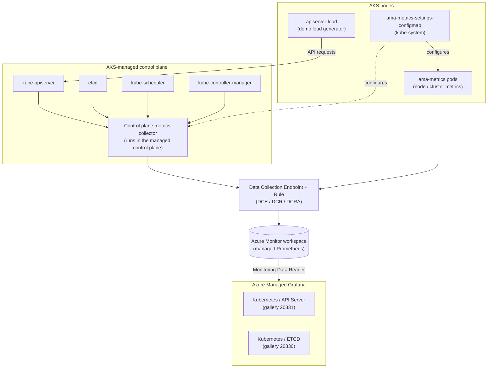

# AKS Control Plane Metrics with Managed Prometheus and Grafana

Enable AKS control plane metrics (API server, etcd, scheduler) and visualize them in Azure Managed Grafana.

## Overview

Normally the AKS control plane (kube-apiserver, etcd, kube-scheduler, kube-controller-manager) is a black box, because Microsoft manages it. The **control plane metrics** feature exposes Prometheus metrics from these components. Azure Monitor managed Prometheus collects them, and Azure Managed Grafana displays them, so you can:

- Watch API server request rate, latency, errors and inflight requests
- Check etcd health: leader status, database size and gRPC traffic
- Spot scheduling pressure (`scheduler_pending_pods`) and controller workqueue backlogs
- Troubleshoot throttling, slow API calls and noisy clients

This demo deploys everything with **Terraform**. It enables control plane metrics, customizes the collection with `ama-metrics-settings-configmap`, imports the official Grafana dashboards and starts a small load generator so the dashboards show live data.

## Architecture



## What gets deployed

| Resource | Name (defaults) | Purpose |
|---|---|---|
| Resource group | `rg-cpmetrics-demo` | Holds all demo resources |
| AKS cluster | `aks-cpmetrics-demo` | Managed identity, Azure CNI Overlay, managed Prometheus add-on |
| Node resource group | `rg-cpmetrics-demo-nodes` | Custom, readable node RG name |
| Azure Monitor workspace | `amw-cpmetrics-demo` | Managed Prometheus metrics store |
| DCE / DCR / DCRA | `dce-…`, `dcr-…`, `dcra-…` | Sends Prometheus metrics to the workspace |
| Control plane metrics | `azapi_update_resource` | Sets `azureMonitorProfile.metrics.controlPlane.enabled = true` |
| Azure Managed Grafana | `amg-cpmetrics-xxxx` | Dashboards, linked to the Azure Monitor workspace |
| Role assignments | – | Grafana MI → *Monitoring Data Reader*, you → *Grafana Admin* |

## Folder structure

```text
AKS-Control-Plane-Metrics/
├── README.md
├── deploy.sh                       # End-to-end deployment
├── cleanup.sh                      # Destroy everything + remove local state
├── terraform/
│   ├── providers.tf
│   ├── variables.tf
│   ├── main.tf
│   ├── outputs.tf
│   └── terraform.tfvars.example
└── k8s/
    ├── ama-metrics-settings-configmap.yaml   # Control plane targets & keep lists
    └── apiserver-load-generator.yaml         # Generates API server / etcd traffic
```

## Prerequisites

- Azure subscription with permission to create resources and role assignments (Owner, or Contributor + User Access Administrator)
- [Azure CLI](https://learn.microsoft.com/cli/azure/install-azure-cli) 2.61+ (`az login`)
- Azure CLI `amg` extension (`deploy.sh` installs it): `az extension add --name amg`
- [Terraform](https://developer.hashicorp.com/terraform/install) 1.6+
- [kubectl](https://kubernetes.io/docs/tasks/tools/)

> Control plane metrics are **GA**. You don't need to register a preview feature. The cluster must use a **managed identity** and **Azure Monitor managed Prometheus**.

## Quick start

```bash
cd AKS-Control-Plane-Metrics
chmod +x deploy.sh cleanup.sh

# Option A - Terraform enables control plane metrics (default)
./deploy.sh

# Option B - deploy without it, then enable it with the Azure CLI (good for a before/after demo)
./deploy.sh --enable-with-cli

# Skip the load generator
./deploy.sh --skip-load
```

`deploy.sh` does the following:

1. Checks the prerequisites and gets your Entra object ID (for the *Grafana Admin* role)
2. Runs `terraform init` / `terraform apply`
3. Fetches the AKS credentials
4. (Option B) runs `az aks update --enable-control-plane-metrics`
5. Shows `azureMonitorProfile.metrics` to confirm the feature is on
6. Applies `k8s/ama-metrics-settings-configmap.yaml`
7. Imports the **Kubernetes / API Server** (20331) and **Kubernetes / ETCD** (20330) Grafana dashboards
8. Starts the API server load generator

> Control plane metrics can take **5–10 minutes** to show up in Grafana after you enable them.

## How control plane metrics are enabled

### With Terraform (this demo)

The `azurerm` provider has no argument for control plane metrics yet, so the demo uses `azapi_update_resource`. The update runs **after** the DCR association exists. The Azure CLI uses the same ordering, so the control plane collector starts with its destination already in place:

```hcl
resource "azapi_update_resource" "control_plane_metrics" {
  type        = "Microsoft.ContainerService/managedClusters@2026-04-01"
  resource_id = azurerm_kubernetes_cluster.this.id

  body = {
    properties = {
      azureMonitorProfile = {
        metrics = {
          enabled      = true
          controlPlane = { enabled = true }
        }
      }
    }
  }

  depends_on = [azurerm_monitor_data_collection_rule_association.prometheus]
}
```

To deploy the infrastructure without the feature, set `enable_control_plane_metrics = false`.

### With the Azure CLI

```bash
# New cluster
az aks create -g <rg> -n <cluster> \
  --enable-managed-identity \
  --enable-azure-monitor-metrics \
  --azure-monitor-workspace-resource-id <amw-id> \
  --grafana-resource-id <grafana-id> \
  --enable-control-plane-metrics

# Existing cluster that already has managed Prometheus
az aks update -g <rg> -n <cluster> --enable-control-plane-metrics

# Check it
az aks show -g <rg> -n <cluster> --query "azureMonitorProfile.metrics"

# Disable
az aks update -g <rg> -n <cluster> --disable-control-plane-metrics
```

## Customizing what's collected

Control plane metrics are customized **only** through the `ama-metrics-settings-configmap` ConfigMap in `kube-system` (schema `v2`, `controlplane-metrics` section). The demo version changes these settings:

```yaml
controlplane-metrics: |-
  default-targets-scrape-enabled: |-
    apiserver = true
    etcd = true
    kube-scheduler = true            # off by default
    kube-controller-manager = true   # off by default
    cluster-autoscaler = false
    node-auto-provisioning = false
    istio = false
  default-targets-metrics-keep-list: |-
    apiserver = "apiserver_request_duration_seconds_bucket|apiserver_request_duration_seconds_sum|apiserver_request_duration_seconds_count|apiserver_longrunning_requests"
    etcd = "etcd_network_client_grpc_received_bytes_total|etcd_debugging_mvcc_keys_total"
  minimal-ingestion-profile: |-
    enabled = true
```

- **`default-targets-scrape-enabled`** turns each control plane target on or off.
- **`minimal-ingestion-profile`** (on by default) ingests only a curated set of metrics, which keeps cost down.
- **`default-targets-metrics-keep-list`** is a regex of **extra** metrics to ingest on top of the minimal profile. For histograms, keep the whole `_bucket|_sum|_count` family.

Apply your changes with `kubectl apply -f k8s/ama-metrics-settings-configmap.yaml`. The agent picks them up within a few minutes.

## Exploring the metrics in Grafana

1. Open the Grafana endpoint (`terraform -chdir=terraform output -raw grafana_endpoint`).
2. Go to **Dashboards** and open **Kubernetes / API Server** and **Kubernetes / ETCD**. Pick the *Managed Prometheus* data source and your cluster.
3. Use **Explore** to try these queries:

| Question | PromQL |
|---|---|
| API request rate by verb | `sum by (verb) (rate(apiserver_request_total[5m]))` |
| API responses by status code | `sum by (code) (rate(apiserver_request_total[5m]))` |
| p99 API latency by verb | `histogram_quantile(0.99, sum by (le, verb) (rate(apiserver_request_duration_seconds_bucket[5m])))` |
| Inflight requests | `apiserver_current_inflight_requests` |
| etcd DB size | `etcd_mvcc_db_total_size_in_bytes` |
| etcd has a leader | `etcd_server_has_leader` |
| Pending pods in the scheduler | `scheduler_pending_pods` |
| Controller workqueue depth | `workqueue_depth` |

The load generator (`k8s/apiserver-load-generator.yaml`) runs 3 replicas. Each one LISTs pods, creates and deletes ConfigMaps, and requests a missing object in a loop. You'll see GET/LIST/POST/DELETE traffic, `201`/`200`/`404` response codes and etcd write activity. To see the change on the dashboards, scale it up or down:

```bash
kubectl scale deployment apiserver-load -n cp-metrics-demo --replicas=10
kubectl delete -f k8s/apiserver-load-generator.yaml   # stop the load
```

## Limitations and notes

- **Managed Prometheus only.** Control plane metrics can't be scraped by a self-managed Prometheus.
- **No Azure Monitor Private Link support.**
- **Managed identity is required.** Service principal clusters aren't supported.
- The collector runs **in the AKS-managed control plane**, not inside the `ama-metrics` pods. You won't see it with `kubectl`.
- Metrics can take **several minutes** to show up after the feature is enabled or the ConfigMap changes.
- **Terraform drift:** `azurerm` doesn't know about `controlPlane.enabled`. If a later `azurerm_kubernetes_cluster` change resets it, run `terraform apply` again or `az aks update --enable-control-plane-metrics`.

## Cleanup

```bash
./cleanup.sh       # asks for confirmation
./cleanup.sh -y    # no prompt
```

The cleanup script destroys all Terraform-managed resources and deletes the resource group if anything is left behind. It also removes the kubectl context and deletes the local Terraform state, `.terraform` provider folder and lock file.

## References

- [Monitor the AKS control plane with metrics](https://learn.microsoft.com/azure/aks/control-plane-metrics-monitor)
- [Control plane metrics reference (default minimal ingestion profile)](https://learn.microsoft.com/azure/azure-monitor/containers/prometheus-metrics-scrape-default)
- [Customize scraping with ama-metrics-settings-configmap](https://learn.microsoft.com/azure/azure-monitor/containers/prometheus-metrics-scrape-configuration)
- [Upstream ConfigMap template](https://github.com/Azure/prometheus-collector/blob/main/otelcollector/configmaps/ama-metrics-settings-configmap.yaml)
- Grafana dashboards: [Kubernetes / API Server (20331)](https://grafana.com/grafana/dashboards/20331), [Kubernetes / ETCD (20330)](https://grafana.com/grafana/dashboards/20330)
