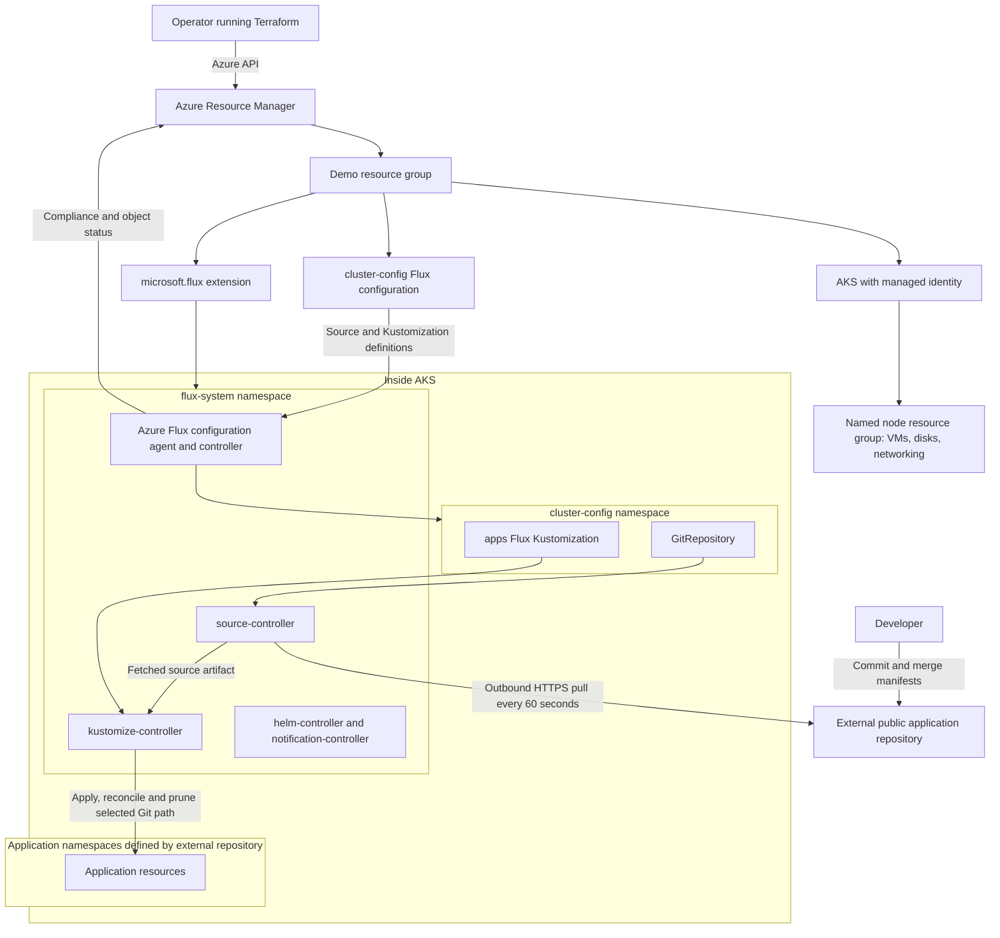

# AKS Flux Extension Demo

Configure AKS with the managed Flux extension and demonstrate GitOps reconciliation with Terraform.

## Overview

Terraform creates a small AKS cluster, installs the Azure-managed `microsoft.flux`
extension, and connects it to your external public application repository.
An optional Podinfo sample is included under [gitops](gitops). Git is the workload source of truth:
changes are pulled into AKS, and manual changes are corrected automatically.

See [Architecture](#architecture) for the diagram, resource ownership, networking,
and security trade-offs. No Azure resources are created until you run deployment.

## Architecture

The demo separates infrastructure ownership (Terraform) from continuous workload
delivery (Flux). A Git push does not require inbound access from GitHub to AKS.



### Reconciliation Sequence

1. Terraform creates the resource group and managed-identity AKS cluster.
2. Terraform installs the managed `microsoft.flux` extension on the Stable train.
   No version is pinned, allowing Azure's extension auto-upgrade behavior.
3. Terraform creates `cluster-config` after the extension. Azure's agents create
   the GitRepository and Flux Kustomization custom resources.
4. The source controller polls the public Git repository over HTTPS every 60 seconds.
5. The `apps` Kustomization reconciles the exact directory selected by `gitops_path`.
   Namespaces and prerequisites must be included in that configuration or already
   exist. This demo does not require an `infra/apps` layout in the external repo.
6. Failed reconciliation retries every 30 seconds; the Kustomization has a
   five-minute timeout. The deployment script displays status without assuming
   a particular application or waiting for its rollout.
7. Flux regularly corrects drift and prunes resources removed from the source.
   Controllers and Azure agents report their status independently of Terraform.

Any `kustomization.yaml` in your external repository is a Kustomize build definition,
not a Flux `Kustomization` custom resource. Azure generates the Flux resource from
the Terraform configuration, including source path, interval and pruning settings.
See [Is Flux Bootstrap Needed?](#is-flux-bootstrap-needed) for how this differs
from self-managed Flux installation.

### Ownership

| Owner | Resources |
| --- | --- |
| Terraform | Resource group, AKS, Flux extension, Azure Flux configuration. |
| AKS | Node resource group, node VMs, disks and cluster networking. |
| Managed extension | Flux controllers and Azure configuration agents in `flux-system`. |
| Azure configuration agents | GitRepository and Flux Kustomizations in `cluster-config`. |
| External application Git repository and Flux | Resources declared at the selected Git path. |

Terraform's explicit dependency ensures the configuration is destroyed before
the extension. The cluster is destroyed only after its configuration and extension.
Terraform does not apply application manifests directly. Flux deploys either the
bundled sample or resources from your external repo. Your external repo
can provision resources with their own cleanup requirements, including Helm
releases, public load balancers and retained persistent disks. Review those
lifecycles separately; do not assume deleting this demo removes retained resources
outside its resource groups.

### Networking

- Azure CNI Overlay with Cilium provides pod networking and policy capability.
  This demo does not define application NetworkPolicies or a custom VNet.
- The Kubernetes API is public for simple local administration. The demo uses
  local kubeconfig authentication with Kubernetes RBAC enabled, not Entra ID login.
- Git access is outbound HTTPS: no webhook receiver or inbound GitHub connection
  is required. GitHub supplies manifests; application images come from the
  registries referenced by your external repository.
- Azure agents need outbound HTTPS to `management.azure.com`,
  `<region>.dp.kubernetesconfiguration.azure.com`, `login.microsoftonline.com`, and
  `mcr.microsoft.com`, plus normal AKS outbound dependencies. Restricting egress
  requires allowing these documented service endpoints and image-layer endpoints.
- Application exposure, ingress, DNS, certificates and NetworkPolicies are
  determined by your external manifests, not by this infrastructure demo.

### Demo Decisions And Production Changes

This uses a conventional AKS cluster with a fixed node pool instead of AKS
Automatic so node count, resource names and Terraform ownership are explicit for
the tutorial. The Free control-plane tier, two shared system/workload nodes,
public API, and local authentication keep the example small; this is not a
production landing zone or a highly available reference architecture.

The AKS control plane uses a system-assigned managed identity. The public Git
source needs no Git credentials. Cluster-scoped reconciliation supports resources
across namespaces but grants powerful cluster-wide permissions: only trusted
contributors should be able to modify the tracked source. Apply workload security
controls, probes and resource limits in your application repository. The optional
Podinfo sample includes non-root execution, a read-only root filesystem, resource
limits, probes, and a namespace enforcing restricted Pod Security. Image automation
is not enabled; image-version changes must be reviewed and committed to Git.

For production, evaluate a private/restricted API endpoint, Entra ID and Azure
RBAC with local accounts disabled, namespace-scoped tenant configurations,
authenticated private Git sources, protected branches, pinned image digests,
dedicated workload pools, zones, autoscaling and disruption budgets. Add Azure
Monitor/managed Prometheus, upgrade/maintenance policies, NetworkPolicies and a
secured remote Terraform backend. None of those services are silently provisioned
by this focused demo. Local state and kubeconfig remain sensitive even though they
are gitignored.

## Files

```text
AKS-Flux-Extension/
  README.md
  deploy.sh
  cleanup.sh
  gitops/
    kustomization.yaml
    infra/
      kustomization.yaml
      namespace.yaml
    apps/
      kustomization.yaml
      deployment.yaml
      service.yaml
  terraform/
    versions.tf
    variables.tf
    main.tf
    outputs.tf
    terraform.tfvars.example
```

## Prerequisites

- Azure CLI, Terraform >= 1.6, kubectl, Git, and jq for cleanup.
- An Azure subscription with permission to create resource groups, AKS, and
  `Microsoft.KubernetesConfiguration/extensions` and `fluxConfigurations` resources.
  Provider registration also requires subscription-level permission; ask an
  administrator to register the providers if necessary.
- Enough regional VM quota for two `Standard_D2s_v6` nodes (four vCPUs, plus upgrade
  headroom). Change the size or region if unavailable.
- A **public application repository and published branch containing Kubernetes
  manifests or a Kustomize configuration** at the path you select.
- Outbound HTTPS to GitHub, your application's image registries, Microsoft
  Container Registry and the Azure
  endpoints described in [Networking](#networking).

This is a new-cluster demo, not an installer for an existing cluster. It does not
install self-managed Flux with `flux bootstrap`; Azure manages the extension.

## Is Flux Bootstrap Needed?

**No `flux bootstrap` command is needed with this AKS extension setup.**

In a typical self-managed OSS setup, `flux bootstrap` installs Flux controllers,
writes their manifests and sync configuration to Git, and connects the cluster to
that repository. It is a convenient workflow, not the only way to install OSS Flux.

Here, Terraform creates two Azure resources instead:

1. `azurerm_kubernetes_cluster_extension` installs the managed Flux controllers.
2. `azurerm_kubernetes_flux_configuration` tells Azure's agents to create the
  GitRepository and Flux Kustomization resources for your repository and path.

The extension alone does not select an application repository. Both resources
are needed in this demo. Azure does not commit bootstrap manifests to your Git
repository, and you should not bootstrap a second Flux installation over the
managed extension.

## 1. Prepare Your Application Repository

Choose an existing public GitHub repository and a published branch. Set
`gitops_path` to the exact directory Flux should reconcile, for example `./apps`,
`./clusters/demo`, or `./` if the repository root contains only deployable content.
The directory should contain Kubernetes YAML or a `kustomization.yaml` referencing
the application resources. A Helm chart alone is not sufficient: use appropriate
Flux HelmRepository/HelmRelease resources if your application is Helm-based.

Include any required Namespace manifests and application prerequisites in the
selected configuration, or ensure they already exist. For external applications,
the demo does not assume a namespace or an `infra/apps` directory layout. Avoid
pointing Flux at a broad directory containing unrelated or non-Kubernetes YAML.

Flux cannot read uncommitted files or a branch that only exists locally.
Keep local Terraform settings and state out of Git.

### Use The Bundled Sample

The optional [gitops](gitops) directory contains a Podinfo Deployment with a
Kustomize override setting three replicas,
a ClusterIP Service on port 9898, and the `flux-demo` namespace. Its root
[kustomization.yaml](gitops/kustomization.yaml) includes both `infra` and `apps`,
so they are reconciled by the existing single `apps` Flux Kustomization.

Publish these files to your public repository and branch first. To use a fork of
this repository, set these values in your ignored Terraform variables file:

```hcl
git_repository_url = "https://github.com/YOUR-ACCOUNT/Code-Snippets.git"
git_branch         = "main"
gitops_path        = "./AKS-Flux-Extension/gitops"
```

Alternatively, place the entire `gitops` directory in your separate application
repository and set `gitops_path = "./gitops"`. Select the root directory, not only
`gitops/apps`, so Flux also creates the namespace. Use your published feature branch
in `git_branch` if the files are not yet available on `main`.

After deployment, with the demo's `KUBECONFIG` exported:

```bash
kubectl wait --for=create deployment/podinfo -n flux-demo --timeout=600s
kubectl rollout status deployment/podinfo -n flux-demo --timeout=300s
kubectl port-forward -n flux-demo service/podinfo 9898:9898
```

Open <http://localhost:9898> while the port-forward is running. For the Git-change
and drift walkthroughs below, use `APP_NAMESPACE="flux-demo"` and
`APP_DEPLOYMENT="podinfo"`. Change `replicas[].count` in
[gitops/apps/kustomization.yaml](gitops/apps/kustomization.yaml) to adjust the replica
count; this overrides `spec.replicas` in the Deployment manifest. Change
`PODINFO_UI_MESSAGE` in [gitops/apps/deployment.yaml](gitops/apps/deployment.yaml)
to update the message. Publish changes to the configured Git source. No public
application endpoint is created by this sample.

#### Example Browser Output

Opening <http://localhost:9898/> in a browser displays the Podinfo UI with the
configured message, serving pod name, version, and Ping button:


Podinfo serves HTML to browser User-Agent headers and JSON to ordinary CLI requests.
The UI loads Vue and Vuetify from `cdn.jsdelivr.net`. If Brave Shields or another
script blocker produces a blank page, allow those scripts for this localhost site
or disable Shields for this site only, then reload. This is a browser issue, not a
Flux or Kubernetes connectivity failure.

#### Example CLI Output

Keep the port-forward running and use a second terminal:

```bash
curl --fail --silent --show-error http://localhost:9898/ | jq
```

Example response from the same application:

```json
{
  "hostname": "podinfo-6d884f55cc-l8s5p",
  "version": "6.7.1",
  "revision": "6b7aab8a10d6ee8b895b0a5048f4ab0966ed29ff",
  "color": "#34577c",
  "logo": "https://raw.githubusercontent.com/stefanprodan/podinfo/gh-pages/cuddle_clap.gif",
  "message": "Hello from AKS Flux GitOps",
  "goos": "linux",
  "goarch": "amd64",
  "runtime": "go1.23.2",
  "num_goroutine": "6",
  "num_cpu": "4"
}
```

The hostname and runtime fields vary by pod and node; version and revision vary
with the deployed image. To request the HTML response from the CLI instead:

```bash
curl --fail --silent --show-error --user-agent 'Mozilla/5.0' http://localhost:9898/
```

## 2. Configure And Deploy

Run from the repository root:

```bash
cd AKS-Flux-Extension
az login
az account set --subscription "<your-subscription-name>"
cp terraform/terraform.tfvars.example terraform/terraform.tfvars
```

The deployment and cleanup scripts use the active Azure CLI subscription for
Terraform automatically. Select the intended subscription with `az account set`
before running them.

Edit the ignored `terraform/terraform.tfvars`:

```hcl
git_repository_url = "https://github.com/YOUR-ACCOUNT/YOUR-APP-REPO.git"
git_branch         = "main"
gitops_path        = "./apps"
```

Use a distinct `project` or `environment` if the default resource names already
exist. Set `kubernetes_version` only if you need a particular supported version;
otherwise AKS selects its regional default.

```bash
bash deploy.sh
export KUBECONFIG="$PWD/kubeconfig"
```

The script registers required resource providers, validates local files, and runs
`terraform apply` with automatic plan approval; it does not pause to display the
plan for approval. Review your variables before running it. It then downloads a
dedicated, gitignored kubeconfig and displays Flux source and reconciliation
status. It does **not** validate remote application manifests or wait for a
particular Deployment. It does not apply application manifests directly: only Flux
deploys the workload.

Defaults create `rg-flux-demo`, `aks-flux-demo`, and `rg-flux-demo-nodes`.
Provisioning typically takes several minutes. Initial reconciliation can take
longer than its normal 60-second interval. A successful Terraform apply alone
does not prove that Git reconciliation succeeded.

## 3. Inspect The Extension And Configuration

Install the Azure CLI inspection extensions if they are not already installed:

```bash
az extension add --name k8s-extension --upgrade
az extension add --name k8s-configuration --upgrade

RESOURCE_GROUP="$(terraform -chdir=terraform output -raw resource_group_name)"
CLUSTER_NAME="$(terraform -chdir=terraform output -raw cluster_name)"

az k8s-extension show --resource-group "$RESOURCE_GROUP" \
  --cluster-name "$CLUSTER_NAME" --cluster-type managedClusters --name flux

az k8s-configuration flux show --resource-group "$RESOURCE_GROUP" \
  --cluster-name "$CLUSTER_NAME" --cluster-type managedClusters --name cluster-config

kubectl get pods -n flux-system
kubectl get gitrepositories.source.toolkit.fluxcd.io -n cluster-config
kubectl get kustomizations.kustomize.toolkit.fluxcd.io -n cluster-config
```

Expect the extension provisioning state to be `Succeeded`, the configuration to
become `Compliant`, and the GitRepository and `apps` Flux Kustomization to report
`READY=True`. Azure-generated object names may include the configuration-name
prefix. Verify your own application separately:

```bash
APP_NAMESPACE="<your-app-namespace>"
APP_DEPLOYMENT="<your-deployment-name>"
kubectl get deployment,pods,service -n "$APP_NAMESPACE"
kubectl rollout status deployment/"$APP_DEPLOYMENT" -n "$APP_NAMESPACE" --timeout=300s
```

In the Azure portal, open the AKS resource and select **GitOps**, then
**cluster-config**, to inspect configuration objects and their compliance state.

## 4. Demonstrate A Git-Driven Change

In your external application repository, change a Deployment's replica count or
image tag. Commit and push those changes to the **same repository and branch**
configured in Terraform, using your normal
feature-branch and PR workflow. When tracking `main`, merge the PR before expecting
a change in AKS.

```bash
kubectl get deployment "$APP_DEPLOYMENT" -n "$APP_NAMESPACE" --watch
```

Within a few reconciliation intervals, the Deployment reflects the Git change.
Inspect Kustomization status to associate
the applied revision with your Git commit. No second Terraform apply is needed
for workload-only changes.

## 5. Demonstrate Drift Correction

Once the committed replica count has reconciled, introduce a manual change:
use a replica count different from Git, and choose a Deployment not managed by
an HPA or another scaling controller.

```bash
kubectl scale deployment/"$APP_DEPLOYMENT" -n "$APP_NAMESPACE" --replicas=1
kubectl get deployment "$APP_DEPLOYMENT" -n "$APP_NAMESPACE" --watch
```

Flux restores the replica count declared in Git, normally within a few intervals.
For a persistent change, edit Git rather than using `kubectl scale`.
To roll back, revert the workload change in Git and publish the revert through
the same branch/PR workflow; Flux reconciles the reverted state.

The `apps` Kustomization enables pruning (`garbage_collection_enabled = true`).
Resources previously managed by it are deleted when removed from the source.
Use disposable resources for pruning experiments: removing a Namespace can delete
**all its contents**. If migrating an already-deployed version of this demo, review
the Terraform plan: removing the former `infra` Kustomization or changing the source
path can prune the old sample resources, including its namespace.

## Troubleshooting

| Symptom | Check |
| --- | --- |
| Source is not ready | Public repo URL, published branch, and Git connectivity. |
| Path not found | `gitops_path` is relative to the repository root, not your local working directory. |
| Namespace or prerequisite missing | Include it in the external configuration or provision it before reconciliation. |
| Pods are Pending | Node capacity, VM quota and scheduling events. |
| ImagePullBackOff | Application image registry connectivity, tag and pull credentials. |
| Azure shows Non-compliant initially | Allow reconciliation time, then inspect source and Kustomization errors. |
| Script completes but app is missing | Inspect Flux conditions; Terraform provisioning does not guarantee successful workload reconciliation. |

```bash
kubectl describe gitrepositories.source.toolkit.fluxcd.io -n cluster-config
kubectl describe kustomizations.kustomize.toolkit.fluxcd.io -n cluster-config
kubectl logs -n flux-system deployment/source-controller --tail=100
kubectl logs -n flux-system deployment/kustomize-controller --tail=100
kubectl get events -n "$APP_NAMESPACE" --sort-by=.lastTimestamp
```

Do not install a second self-managed Flux instance over the extension. Private
Git repositories require additional authentication configuration and are outside
this credential-free demo. Do not put tokens in URLs, manifests, or committed tfvars.

## Cleanup And Cost

AKS worker VMs, disks, and networking incur charges even though the control plane
uses the Free tier. Delete the demo when finished:

```bash
bash cleanup.sh
unset KUBECONFIG
```

Type `destroy` to confirm cleanup. Terraform's destroy plan is then approved
automatically, without a separate plan review prompt. Terraform deletes the Flux
configuration before the extension, then the cluster and resource group. After a
successful Terraform destroy, the script removes the demo cluster's context,
cluster, and user entries from its dedicated `kubeconfig` file, but retains the file.
It verifies that both known resource groups are absent before removing local state
and the `.terraform` provider directory. If destroy fails, the kubeconfig is left
intact for investigation; if verification fails, it preserves state for retry. It
does not modify your shared `~/.kube/config` or other kubeconfigs.

Use the same subscription, variables and local state used for deployment. For an
interrupted initial apply, `terraform destroy` also removes resources recorded in
partial state; resource-group outputs might not yet be available for the extra
group-absence checks. Never remove state manually to work around a failed destroy.
The source repository and your ignored tfvars are retained.
Application resources such as public IPs or persistent disks may depend on your
external manifests and retention policies; check for retained resources after
cleanup. The group checks only cover the demo's two known resource groups.

## Local Validation

```bash
terraform -chdir=terraform fmt -check
terraform -chdir=terraform init -backend=false -input=false
terraform -chdir=terraform validate
shellcheck -S warning -e SC2034,SC2046,SC2207 deploy.sh cleanup.sh
yamllint -d '{extends: relaxed, rules: {line-length: {max: 200}}}' gitops
kubectl kustomize gitops
```

Validate your external application manifests in their own repository before
publishing, using its existing lint, Kustomize, or Helm checks.

## References

- [Microsoft Learn: GitOps with Flux v2](https://learn.microsoft.com/azure/azure-arc/kubernetes/tutorial-use-gitops-flux2)
- [Flux configuration parameters](https://learn.microsoft.com/azure/azure-arc/kubernetes/gitops-flux2-parameters)
- [AKS cluster extensions](https://learn.microsoft.com/azure/aks/cluster-extensions)
- [Terraform Flux configuration](https://registry.terraform.io/providers/hashicorp/azurerm/latest/docs/resources/kubernetes_flux_configuration)
- [Terraform cluster extension](https://registry.terraform.io/providers/hashicorp/azurerm/latest/docs/resources/kubernetes_cluster_extension)
- [Podinfo](https://github.com/stefanprodan/podinfo)
