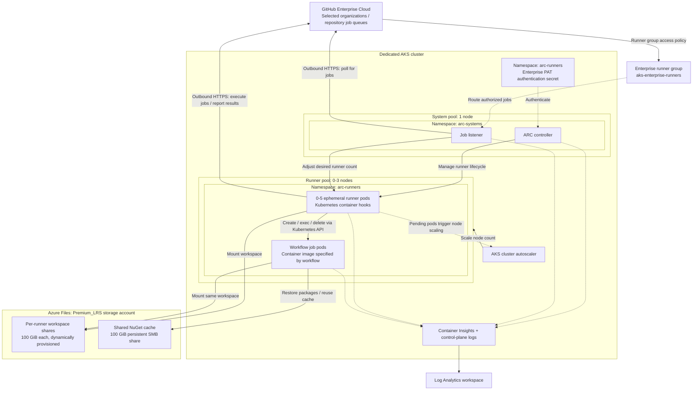

# Enterprise GitHub Actions Runners on AKS

Run enterprise-scoped GitHub Actions container jobs on AKS with Actions Runner Controller and Azure Files.

This experiment provisions Azure resources with Terraform, then installs GitHub's
modern **runner scale set** Helm charts. It does not use legacy `RunnerDeployment`
resources, cert-manager, or GitHub webhook ingress. Following the Microsoft
Azure Files approach, **Kubernetes container mode** runs workflow jobs in separate
pods, with Premium SMB shares for runner workspaces and a persistent NuGet cache.
There is no Docker daemon or privileged Docker-in-Docker (DinD) sidecar.
The primary walkthrough registers the runner scale set at **GitHub Enterprise
Cloud scope**, sharing it only with selected organizations and repositories.
Repository/organization registration remains available for smaller experiments.

## Architecture and defaults



Namespace membership and node placement are shown separately: the authentication
secret is namespace-scoped, not assigned to a node pool. All GitHub connections
originate from the cluster; no incoming webhook is required.

| Decision | Demo configuration / rationale |
| ---------- | ------------------------------- |
| Cluster type | AKS Standard, Free tier; explicit pools and cluster autoscaler rather than AKS Automatic/NAP |
| Node resource group | `rg-gha-runners-dev-nodes`, explicitly named and managed by AKS |
| Nodes | Azure Linux 3, x86-64 `Standard_D4as_v5`; one persistent system node |
| Networking (Day 0) | Azure CNI Overlay + Cilium, standard load balancer egress, no inbound application service |
| API access (Day 0) | Public endpoint restricted to your workstation/VPN IPv4 CIDRs |
| Azure access | Entra ID + Azure RBAC; local accounts disabled; deploying identity gets cluster admin |
| GitHub access | Enterprise PAT (classic), explicit enterprise runner group; optional App auth for repo/org scope |
| Scaling | ARC scales pods from queued jobs; AKS scales runner nodes from pending pods |
| Container mode | Kubernetes hooks; every workflow job must specify `container:` |
| Storage | Azure Files CSI; 100 GiB per-runner RWX workspace, plus a persistent 100 GiB NuGet cache |
| Storage authentication | CSI controller/kubelet managed identities retrieve SMB keys; no account-key Kubernetes secret |
| Versions | ARC charts 0.15.0, runner 2.338.0; AzureRM ~> 5.9 |
| Observability | Container Insights; API server, audit-admin and cluster-autoscaler logs |

The system pool and listener stay running even when runners reach zero. Runner
nodes take several minutes to provision on the first job. `maxRunners: 5` is a
runner cap, **not** a node cap. Each runner requests 250m CPU / 512 MiB; each job
container requests 500m CPU / 1 GiB. Both runner and job pods use the tainted
runner pool. Service containers add further resources; tune limits accordingly.

This is **not a production/high-availability configuration**. Production needs
multiple system nodes, zone redundancy, a paid control-plane tier, private API
connectivity, controlled egress, durable log collection and tighter governance.
API/overlay CIDR choices affect later connectivity and should be planned before
provisioning. No Azure permissions are granted to jobs: use GitHub OIDC with a
separately scoped identity for any subsequent Azure deployment workflow.

## Prerequisites

- Azure subscription with permission to provision AKS and create role assignments
  (for example Contributor plus User Access Administrator).
- Terraform 1.9+, Azure CLI, `kubectl`, `kubelogin`, Helm with OCI support,
  `jq` (cleanup), and `openssl` (GitHub App authentication).
- A GitHub Enterprise Cloud account, an enterprise owner account for registration,
  and a private test repository in an allowed organization. Enterprise and
  organization policies must allow self-hosted runners. For repo/org-only
  experiments, runner administration permission on that scope is enough.
- Enough regional quota for the system node, up to three runner nodes, and upgrade
  surge nodes. Choose another supported non-burstable **amd64** VM size if needed.
- Outbound access to GitHub, GHCR, MCR, NuGet and Azure endpoints, including
  node-level SMB TCP 445 access to Azure Files.
- A currently supported AKS Kubernetes version >= 1.29.

## 1. Configure infrastructure

Run from this demo directory:

```bash
az login
cp terraform/terraform.tfvars.example terraform/terraform.tfvars
```

Edit `terraform/terraform.tfvars`. Replace `203.0.113.10/32` with your
workstation/VPN's real public egress IPv4 CIDR. Terraform rejects the placeholder
and unrestricted `0.0.0.0/0`. Choose region and node size as appropriate. Leave
`kubernetes_version` unset to use AKS's recommended version.

Terraform creates a dedicated `FileStorage` Premium_LRS account with a
`nuget-cache` SMB share. `cache_share_quota_gib` defaults to 100. The installer
creates a static RWX PV/PVC for this cache and a dedicated
`arc-azurefile-premium` StorageClass targeting **the same account**. Each runner
gets its own generic ephemeral PVC and 100 GiB share, shared only with that
runner's job/action pods. Workspace PVs use `Delete`; the cache PV uses `Retain`
and survives ARC reinstalls, but **not a full Terraform destroy**.

The Files CSI controller uses the cluster identity (Storage Account Contributor
on this account) to provision/delete workspace shares. At mount time, kubelets
use their identity (Storage Account Key Operator Service Role on this account)
to retrieve SMB keys. `storeAccountKey: "false"` avoids storing those keys in
Kubernetes Secrets; this is **not keyless SMB**. RBAC propagation may briefly
delay the first mount. The account uses an authenticated public storage endpoint
for the demo; production needs private endpoints/firewall rules and DNS design.

The scripts use your selected Azure CLI subscription unless `ARM_SUBSCRIPTION_ID`
is set. Terraform outputs record the subscription so subsequent Kubernetes access
and cleanup target the same cluster. Kubeconfig is isolated in `.kube/config`,
not merged into your normal kubeconfig.

## 2. Configure enterprise registration and access

Never paste credentials into Terraform variables, Helm values or committed files.
Do not run these scripts with shell tracing (`bash -x`).

### Enterprise runner group

1. As an enterprise owner, open your enterprise's **Policies -> Actions ->
   Runner groups** and create `aks-enterprise-runners`.
2. Set organization access to **Selected organizations** and allow only the
   organization containing your private test repository. Keep public repository
   access disabled.
3. In that organization's **Settings -> Actions -> Runner groups**, configure the
   inherited enterprise group to allow only the intended repositories. Enterprise
   organization access alone does **not** grant a repository access.
4. Optionally restrict the group to selected workflows, using the full
   `OWNER/REPO/.github/workflows/aks-runners-demo.yml@refs/heads/main` path (adjust
   the default branch). Only jobs directly defined in allowed workflows can use
   the group; review this when introducing reusable workflows.

The installer registers the scale set into an **existing** group. It does not
create groups or broaden access policies. Enterprise registration is a GitHub
scope setting; it does not make this one-system-node Azure cluster production HA.

### Enterprise authentication: PAT (classic)

Create a short-lived **personal access token (classic)** from an enterprise owner
account with **`manage_runners:enterprise`** scope (shown under `admin:enterprise`
in the token UI). Do not grant the broader enterprise administration scopes
unless separately needed. GitHub App and fine-grained PAT authentication are
not supported for this enterprise registration flow. Follow enterprise token/
SSO policies and use a dedicated, approved automation account where appropriate.

Use your enterprise **URL slug**, not its display name:

```bash
export GITHUB_CONFIG_URL="https://github.com/enterprises/YOUR-ENTERPRISE-SLUG"
export GITHUB_RUNNER_GROUP="aks-enterprise-runners"
export GITHUB_AUTH_MODE="pat"
read -r -s -p "Enterprise runner PAT: " GITHUB_PAT; echo
export GITHUB_PAT
```

The script rejects enterprise App authentication and missing runner groups
before provisioning. It cannot verify token scopes or enterprise access policies
locally; ARC registration and a workflow from an allowed repository are the
live verification steps. This example targets GitHub.com Enterprise Cloud;
GitHub Enterprise Server and enterprise-specific non-GitHub.com domains require
additional endpoint/TLS configuration and are outside this demo.

### Alternative: repository or organization GitHub App

Create and install a GitHub App on the account/organization owning the target:

- Repository scope: **Administration: Read and write**, **Metadata: Read-only**.
- Organization scope: **Self-hosted runners: Read and write**; repository
  Administration permission is unnecessary for organization registration.
- Install it on the intended repositories and download its private key **outside
  this repository**. The installation ID is not the App ID.

```bash
export GITHUB_CONFIG_URL="https://github.com/YOUR-OWNER/YOUR-REPOSITORY"
unset GITHUB_RUNNER_GROUP
export GITHUB_AUTH_MODE="app"
export GITHUB_APP_ID="123456"
export GITHUB_APP_INSTALLATION_ID="654321"
export GITHUB_APP_PRIVATE_KEY_FILE="$HOME/.config/github/arc-demo.pem"
```

For repository scope, unset `GITHUB_RUNNER_GROUP` because repository runners do
not use runner groups. For organization runners, use
`https://github.com/YOUR-ORG` and set `GITHUB_RUNNER_GROUP` to a pre-created
organization group assigned only to trusted repositories.

### Alternative: repository or organization PAT (classic)

Use a short-lived PAT (classic) with `repo` scope for repository runners or
`admin:org` for organization runners. The token's owner needs runner administration
permissions; authorize SSO if your organization requires it.

```bash
export GITHUB_CONFIG_URL="https://github.com/YOUR-OWNER/YOUR-REPOSITORY"
unset GITHUB_RUNNER_GROUP
export GITHUB_AUTH_MODE="pat"
read -r -s -p "GitHub PAT: " GITHUB_PAT; echo
export GITHUB_PAT
```

The installer reads secret material from files, pipes the Kubernetes Secret
directly into the API using server-side apply, and removes temporary files.
GitHub credentials are not passed in CLI literals, included in Helm release values,
or written to Terraform state. AzureRM storage account resources can
still record storage keys in Terraform state; secure the state accordingly.
The Kubernetes Secret remains sensitive: cluster administrators
can read it; restrict access and rotate it.

## 3. Deploy

```bash
bash deploy.sh
```

The script validates prerequisites/configuration, initializes and validates
Terraform, shows a saved plan, and asks for `yes` before creating billable
resources. It then obtains Entra credentials, waits for RBAC propagation, installs
both pinned charts and waits for the listener to be ready.
It also installs the cache PV/PVC, workspace StorageClass, Cilium policies and
job-hook ConfigMap. Runner namespaces enforce **baseline** Pod Security admission,
not privileged admission.

For subsequent ARC configuration changes or authentication rotation:

```bash
bash scripts/install-arc.sh
```

Use the same authentication mode when rotating. Switching App/PAT authentication
requires replacing the existing `github-auth` secret to avoid retaining old
credential keys. Do this only after draining jobs, then reinstall ARC. Chart
upgrades can require CRD updates; read upstream release notes before changing
`ARC_VERSION` in `scripts/common.sh`. Keep both charts on the same version.
GitHub requires runner software to remain current; refresh the image pins
regularly rather than leaving this demo unattended indefinitely.

### Migrating a previously deployed DinD version

Drain jobs and uninstall the existing `aks-arc-runners` release while leaving the
controller running before deploying this revision. This changes service-account
permissions, workspace volumes and job execution behavior, so do not migrate
active runners in place. Remove the old standard NetworkPolicy after draining:

```bash
export KUBECONFIG="$PWD/.kube/config"
helm uninstall aks-arc-runners -n arc-runners --wait --timeout 15m
kubectl delete networkpolicy runner-egress -n arc-runners --ignore-not-found
bash deploy.sh
```

The new Cilium policies allow runner hooks to access the API. Workflows must be
updated to use `container:` before submitting jobs to the new runner set.

## 4. Run the smoke and scaling workflow

Copy `workflows/aks-runners-demo.yml` to
`.github/workflows/aks-runners-demo.yml` **in a private repository allowed by the
enterprise runner group** (or the configured repository for repository scope).
Commit it and make it available on that repository's default branch for manual
dispatch. It is deliberately not installed as an active workflow in this repo.

Open **Actions -> AKS ARC Azure Files demo -> Run workflow**. Five matrix jobs
target `runs-on: aks-arc-runners`, run inside .NET SDK job containers, restore
Newtonsoft.Json into `/nuget/packages`, build/run a console app and pause for one
minute. Persistent markers under `/nuget/demo-markers` show cache continuity
across subsequent workflow runs. With ARC, use the scale set name, not
`[self-hosted, linux, x64]`.
The hook sets both `NUGET_PACKAGES=/nuget/packages` and
`NUGET_SCRATCH=/nuget/scratch` on the same share so concurrent restores coordinate
NuGet filesystem locks rather than using independent per-pod scratch directories.
The same workflow works across allowed organizations: registration remains at
enterprise scope, while workflows always live in repositories. Use a unique
scale set name within the accessible groups to avoid ambiguous routing.

Check **Enterprise -> Policies -> Actions -> Runners / Runner groups** for the
scale set, then dispatch the workflow from an allowed repository. Confirm it
finishes on the AKS runners. A repository not allowed by the inherited group must
not be able to use these runners; its job may remain queued rather than produce
an immediate error. Check enterprise **and** organization/repository policy when
diagnosing queued jobs.

```bash
export KUBECONFIG="$PWD/.kube/config"
kubectl get pods -n arc-runners -w
# In another terminal with the same KUBECONFIG:
kubectl get nodes -L workload -w
kubectl get pods -n arc-systems
kubectl get autoscalingrunnersets.actions.github.com -n arc-runners
kubectl get pvc -n arc-runners
kubectl get pv
```

Expected: listener remains on the system pool; ephemeral runners land only on
the runner pool along with their job pods, complete one job each, then disappear.
Per-runner PVCs/shares are deleted after their owning pods are removed; the
`nuget-cache` PVC/share remains. After the autoscaler
idle delay, runner nodes return to zero. No checkout step is needed for this
smoke test; the standard runner image is not a full `ubuntu-latest` VM, so install
your build tools in the workflow's job image for real projects.

### Container-mode limitations

Every job requires `container:`; the chart injects
`ACTIONS_RUNNER_REQUIRE_JOB_CONTAINER=true`. Image-based container actions can
use the hooks, but Dockerfile-based actions and direct `docker build` commands
are not supported by this configuration. Use a separately reviewed image-build
solution if needed. Docker `container.options` are not generally supported by
the hooks. Shared NuGet caches are only for jobs within the same trust boundary:
untrusted jobs could poison packages for subsequent builds.

## Security boundaries

- **Only trusted code.** Do not attach these runners to untrusted fork PRs or
  public PR workflows. Manual dispatch alone is not a boundary if other
  workflows can select the runner set. Limit runner group/repository access.
- All organizations using this scale set share its cache and runner credentials.
  Use separate scale sets, namespaces, storage and appropriately scoped credentials
  for different trust boundaries; enterprise registration is not tenant isolation.
- No DinD or privileged containers are configured. Dedicated pools/namespaces
  are still **not** a hard security boundary; keep this cluster separate from
  production workloads.
- Runner hooks need mounted service-account tokens and namespace-scoped
  permissions to create/exec/delete pods and read/create/delete secrets.
  This includes access to the GitHub credential secret in `arc-runners`:
  Kubernetes mode is **not safe for untrusted code**. Job pods do not mount
  service-account tokens; the hook template applies placement and resource limits.
- Cilium policies allow runner access to the Kubernetes API, DNS and external
  HTTP/HTTPS. Job pods get DNS/external HTTP/HTTPS without the explicit API rule;
  neither policy allows incoming pod traffic. These are defense in depth, not a
  sandbox or a complete destination allowlist. Review policy changes for private
  registries/services. CSI mounts SMB from the node, outside pod egress policy.
- The listener needs Kubernetes access and is intentionally not selected by
  the runner egress policy. No node Docker socket or host filesystem is mounted.
- Pin actions to reviewed commit SHAs in real workflows. Grant job tokens only
  the minimum permissions and use OIDC rather than long-lived Azure credentials.
- Logs can contain workflow secrets; restrict Log Analytics access and configure
  appropriate retention/export. Container Insights is not a guarantee of
  lossless log retention from short-lived pods.
- Terraform local state contains sensitive cluster metadata and may contain
  storage keys even though GitHub credentials are excluded. Never commit it; use a secured remote backend
  for anything beyond this local demo.

## Troubleshooting

| Symptom | Checks |
| --------- | -------- |
| API timeout / forbidden | Verify public egress CIDR, tenant/login, target subscription, deployer RBAC propagation and `kubelogin` |
| Helm chart pull 403 / image pull failure | Check GHCR/Docker Hub access, proxy/firewall policies and registry authentication; do not disable TLS verification |
| Listener fails / 401 / 403 | Inspect controller/listener logs; verify App installation ID, permissions, repository access, PAT expiry and organization policies |
| Enterprise registration fails | Enterprise slug; PAT classic with `manage_runners:enterprise`; enterprise-owner account; existing enterprise group; token/SSO policies |
| Jobs remain queued | Exact `runs-on` name; correct GitHub URL; runner group access; ready listener |
| Runner pods Pending | Runner node quota/capacity, autoscaler events, labels/taints, amd64 node size and resource requests |
| Workspace PVC or mount failure | Files CSI enabled; storage RBAC propagation; node TCP 445; quota and Premium share size; inspect PVC/pod events |
| Container job stays Pending | Hook template ConfigMap, runner-pool taint toleration, amd64 images, requests/limits and workspace/cache PVCs |
| Missing job container / Docker error | Add `container:` to every job; this mode has no Docker daemon |
| Nodes do not scale down immediately | Autoscaler idle delay, active jobs and other pods; system pool intentionally stays running |

```bash
kubectl logs -n arc-systems deployment/arc-controller --tail=100
kubectl get pods -n arc-runners
kubectl get events -n arc-runners --sort-by=.lastTimestamp
# Substitute names from the pod listing:
kubectl logs -n arc-systems LISTENER-POD --tail=100
kubectl logs -n arc-runners RUNNER-POD -c runner --tail=100
kubectl describe pvc -n arc-runners nuget-cache
```

## Cleanup and cost

AKS Free tier does **not** mean free nodes. System compute/disks, runner nodes,
load balancer/public IP, outbound traffic and Log Analytics incur charges.
The 100 GiB Premium cache is billed even with zero runners. Each active runner
provisions another **100 GiB Premium share**, so five runners plus the default
cache can provision 600 GiB. Workspace deletion is asynchronous; verify shares
are removed after runs. ARC removal alone does not delete the persistent cache.
Do not leave the demo running unnecessarily.

Stop workflow submissions and wait for jobs to finish, then:

```bash
bash cleanup.sh
unset GITHUB_PAT
```

Cleanup requires the local Terraform state and original infrastructure variables.
It confirms the target, uninstalls the runner scale set **before** the controller
so GitHub registrations can be removed, destroys all Terraform resources
(including the entire storage account, cache and any remaining workspace shares), verifies
both resource groups are gone, then removes local state/backups, saved plan,
provider cache, lockfile and isolated kubeconfig. If an operation fails, state is
retained: resolve the error and rerun. If the cluster was manually deleted, the
script skips Helm but still destroys the remaining Terraform resources; remove
stale GitHub runners manually if necessary. Revoke the PAT or uninstall the App
when finished. Do not delete state before a successful destroy.

## Local validation (no deployment)

```bash
terraform -chdir=terraform fmt -check
terraform -chdir=terraform init -backend=false -input=false
terraform -chdir=terraform validate
terraform -chdir=terraform test
bash tests/test-scripts.sh
shellcheck -S warning -e SC2034,SC2046,SC2207 deploy.sh cleanup.sh scripts/*.sh tests/*.sh
yamllint -d '{extends: relaxed, rules: {line-length: {max: 200}}}' arc workflows
```

## References

- [GitHub: deploying runner scale sets](https://docs.github.com/en/actions/how-tos/manage-runners/use-actions-runner-controller/deploy-runner-scale-sets)
- [GitHub: authenticating ARC](https://docs.github.com/en/actions/how-tos/manage-runners/use-actions-runner-controller/authenticate-to-the-api)
- [GitHub Enterprise Cloud: runner group access policies](https://docs.github.com/en/enterprise-cloud@latest/actions/how-tos/manage-runners/self-hosted-runners/manage-access)
- [GitHub Enterprise Cloud: self-hosted runner API and token scopes](https://docs.github.com/en/enterprise-cloud@latest/rest/actions/self-hosted-runners#create-a-registration-token-for-an-enterprise)
- [ARC chart configuration](https://github.com/actions/actions-runner-controller/tree/gha-runner-scale-set-0.15.0/charts)
- [Microsoft: GitHub Actions on AKS overview](https://learn.microsoft.com/en-us/azure/aks/github-actions-azure-files-overview)
- [Microsoft: create ARC infrastructure with Azure Files](https://learn.microsoft.com/en-us/azure/aks/github-actions-azure-files-create-infrastructure)
- [Azure Files CSI driver parameters](https://github.com/kubernetes-sigs/azurefile-csi-driver/blob/master/docs/driver-parameters.md)
- [GitHub Kubernetes container hook limitations](https://github.com/actions/runner-container-hooks/blob/main/packages/k8s/README.md)
- [AzureRM AKS resource reference](https://registry.terraform.io/providers/hashicorp/azurerm/latest/docs/resources/kubernetes_cluster)

This demo follows the Microsoft Azure Files/Kubernetes-mode storage pattern,
using Terraform rather than Azure CLI for provisioning. It keeps pinned ARC
versions, isolated node pools and a small dev/test cluster; it does not claim
the high availability suggested by the reference architecture's title.
