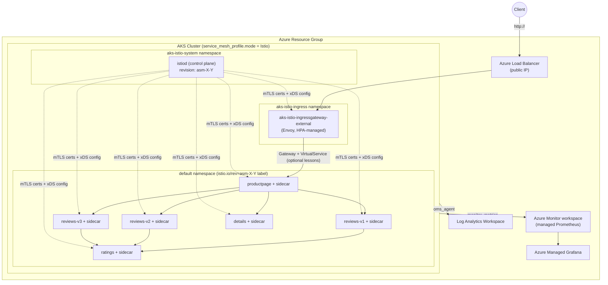

# AKS Istio Service Mesh Add-on Deep Dive

A hands-on deep dive into the **Istio-based service mesh add-on for Azure Kubernetes Service (AKS)**: what it actually installs, mutual TLS, traffic management (canary/weighted routing, header-based routing, fault injection), zero-trust authorization policies, ingress, observability, and — critically — where the managed add-on's guardrails stop and when you should reach for a self-managed, open-source Istio install instead.

> **Not to be confused with:** the [`AKS-Istio-Gateway-API`](../AKS-Istio-Gateway-API/README.md) demo in this repo, which covers the **App Routing (Istio) add-on** — a lightweight, ingress-only Envoy gateway with no sidecars, no mesh, and no CRDs. This demo covers the full **Istio service mesh add-on**: sidecar injection, `istiod`, mTLS everywhere, and the complete Istio CRD surface. See [When to choose which](#when-to-choose-which) for a side-by-side comparison of all three options (App Routing Istio, the mesh add-on, and self-managed OSS Istio).

> **References:**
> [Istio-based service mesh add-on for AKS](https://learn.microsoft.com/azure/aks/istio-about) ·
> [Deploy the add-on](https://learn.microsoft.com/azure/aks/istio-deploy-addon) ·
> [Upgrade the add-on](https://learn.microsoft.com/azure/aks/istio-upgrade) ·
> [Performance & scaling](https://learn.microsoft.com/azure/aks/istio-scale) ·
> [`azurerm_kubernetes_cluster` `service_mesh_profile`](https://registry.terraform.io/providers/hashicorp/azurerm/latest/docs/resources/kubernetes_cluster)

---

## What this demo builds



| Layer | What's provisioned | How |
|---|---|---|
| Resource group + AKS cluster | Azure CNI Overlay, standard LB, system node pool | Terraform (`terraform/main.tf`) |
| **Istio add-on** | `istiod` control plane + optional external ingress gateway, via `service_mesh_profile { mode = "Istio" }` | Terraform |
| Observability (officially verified path) | Log Analytics, Azure Monitor managed Prometheus, Azure Managed Grafana | Terraform |
| Sample mesh app | Istio's `bookinfo` app (productpage/details/reviews v1-v3/ratings) | `deploy.sh` (`kubectl apply` from the istio/istio release matching the installed revision) |
| **Gateway lesson** | Public gateway IP only; no DNS, certificate, or app route is configured automatically | Apply the Istio `Gateway` and `VirtualService` separately from `kubernetes-manifests/ingress/` |
| Traffic management and security | Optional, independent `DestinationRule`, `VirtualService`, `PeerAuthentication`, and `AuthorizationPolicy` examples | Apply the lesson manifests in `kubernetes-manifests/` as you reach them |

---

## Prerequisites

| Requirement | Notes |
|---|---|
| **Azure subscription** with quota for the chosen node VM size (`Standard_D4ds_v5` x 3 by default) | |
| **Azure CLI >= 2.57.0** | Required by the add-on's `az aks mesh` command group. Run `az --version`. |
| **`aks-preview` CLI extension** | Only needed for optional day-2 diagnostics (`az aks mesh get-revisions`, `az aks mesh get-upgrades`). `deploy.sh` installs/updates it best-effort; not required for the Terraform-driven deploy in this demo. |
| **Terraform >= 1.6** | Provisions the AKS cluster with the add-on enabled. |
| **kubectl** | Any recent version compatible with your target Kubernetes version. |
| **jq** | Used by `deploy.sh` (to parse Terraform outputs) and by Terraform itself, via `terraform/scripts/default-istio-revision.sh`, to auto-detect a supported Istio revision when `istio_revisions` is left empty. |
| **`istioctl` (optional)** | Only needed for advanced day-2 operations such as revision-tag based canary upgrades ([Upgrade the add-on](https://learn.microsoft.com/azure/aks/istio-upgrade)) — not required for this demo. |
| **AKS cluster version >= 1.23** | Enforced by Terraform/AKS itself; `terraform.tfvars.example` defaults to a recent GA minor version. |
| No **Open Service Mesh (OSM) add-on** and no **self-managed Istio install** already on the target cluster | The Istio add-on refuses to coexist with either — see [Limitations](#limitations-of-the-aks-istio-add-on). |
| DNS zone, domain, cert-manager, or Helm | Not required. The optional ingress lesson uses the external gateway's IP over HTTP and does not create DNS records or certificates. |

---

## Deploying

```bash
cd AKS-Istio-Service-Mesh-Demo
cp terraform/terraform.tfvars.example terraform/terraform.tfvars
az login
./deploy.sh
```

`deploy.sh` provisions AKS with the Istio add-on and observability stack, fetches credentials, labels the `default` namespace for sidecar injection, and deploys the `bookinfo` sample app. It does **not** apply any Gateway, VirtualService, traffic-management, or security policies: each concept is an opt-in lesson in the walkthrough below. The external gateway is enabled by default so the ingress lesson can use its public IP; no DNS record or TLS certificate is configured. Set `external_ingress_gateway_enabled = false` in `terraform.tfvars` if you do not want a public gateway.

To further customize the deployment (region, node size, ingress gateway placement, a pinned Istio revision, etc.), edit `terraform/terraform.tfvars` as needed.

If upgrading a cluster deployed by an earlier version of this demo, run `./cleanup.sh` before deploying this version. That removes the old DNS record and cluster resources; also remove the obsolete DNS and Let's Encrypt entries from your existing `terraform.tfvars`.

---

## Demo walkthrough

Every manifest in `kubernetes-manifests/` demonstrates one specific Istio concept. Quick reference before diving in:

| # | Concept | Manifest(s) | What it proves |
|---|---|---|---|
| 1 | Sidecar injection | *(automatic — namespace label)* | Every pod gets an Envoy proxy transparently, no app code changes |
| 2 | Mutual TLS (`STRICT`) | `security/peer-authentication-strict.yaml` | Zero-trust transport: plaintext traffic between mesh workloads is rejected |
| 3a | Deterministic routing | `traffic-management/destination-rule-reviews.yaml` + `virtualservice-all-v1.yaml` | `VirtualService`/`DestinationRule` override Kubernetes' default round-robin across all pod versions |
| 3b | Weighted canary rollout | `virtualservice-canary-v3.yaml` | Progressive delivery — shift a % of traffic to a new version without redeploying |
| 3c | Header-based routing | `virtualservice-user-routing.yaml` | Route specific users/cohorts to a specific version (dogfooding, beta rings) |
| 3d | Fault injection | `virtualservice-fault-injection.yaml` | Chaos-test downstream latency/timeout handling without touching app code |
| 4 | Identity-based authorization | `security/authorization-policy-ratings.yaml` | Zero-trust access control keyed on cryptographic workload identity (SPIFFE), not IP/network |
| 5a | Gateway listener | `ingress/gateway.yaml` | Opens an HTTP listener on the AKS-managed external gateway; does not define an application route |
| 5b | VirtualService route | `ingress/virtualservice-productpage.yaml` | Attaches a route to the Gateway and sends `/productpage` traffic to Bookinfo |
| 6 | Observability | `kubernetes-manifests/observability/istio-bookinfo-podmonitor.yaml` + `grafana/istio-service-mesh-dashboard.json` | Scrapes Istio pod metrics into Azure Managed Prometheus and visualizes request rate, 5xx rate, and p95 latency |

### 1. Sidecar injection — the data plane

**What it demonstrates:** Istio's core mechanism — every pod in a labeled namespace gets a second container (`istio-proxy`, an Envoy proxy) injected automatically at admission time. All the concepts below work *because* this proxy transparently intercepts every request in and out of the pod.

```bash
kubectl get pods -n aks-istio-system                  # istiod
kubectl get pods -n aks-istio-ingress                  # external ingress gateway (if enabled)
kubectl get pods -n default -o jsonpath='{range .items[*]}{.metadata.name}{"\t"}{.spec.containers[*].name}{"\n"}{end}'
```

**Expected result:** every `bookinfo` pod lists the app plus an injected `istio-proxy`. On Kubernetes 1.29+ revisions `istio-proxy` may instead run as a *native sidecar* `initContainer` — `kubectl describe pod <pod>` will show it either way.

### 2. Mutual TLS — zero-trust transport security

**What it demonstrates:** apply `security/peer-authentication-strict.yaml` to put the entire mesh in `STRICT` mTLS mode — every sidecar-to-sidecar connection must be mutually authenticated with certificates `istiod` issues and rotates automatically. There is no app-level TLS code anywhere in `bookinfo`.

Apply the policy, then prove plaintext traffic is rejected by running a pod *without* a sidecar (skip injection with an annotation) in the same namespace and trying to call a mesh service directly:

```bash
kubectl apply -f kubernetes-manifests/security/peer-authentication-strict.yaml
kubectl run plaintext-test --image=curlimages/curl --restart=Never --rm -it \
  --annotations="sidecar.istio.io/inject=false" -n default -- \
  curl -sS --max-time 5 http://productpage:9080/productpage
```

**Expected result:** the connection is reset (`curl: (56) Recv failure: Connection reset by peer` or similar) — `productpage`'s own sidecar refuses the plaintext handshake. Delete the `PeerAuthentication` (`kubectl delete peerauthentication default -n aks-istio-system`) and re-run the same command to see it succeed instead.

### 3. Traffic management

The deterministic, canary, and header-routing lessons target the `reviews` service. The canary and header `VirtualService` objects replace the preceding `reviews` VirtualService. Fault injection is a separate lesson for the `ratings` service. Nothing in this section is applied during initial deployment.

**3a. Deterministic routing (baseline).** By default, Kubernetes' `reviews` Service round-robins across *all* `v1`/`v2`/`v3` pods with no control over the mix. `destination-rule-reviews.yaml` defines named subsets by the `version` pod label; `virtualservice-all-v1.yaml` pins 100% of traffic to `v1` (no star ratings).

```bash
kubectl apply -f kubernetes-manifests/traffic-management/destination-rule-reviews.yaml
kubectl apply -f kubernetes-manifests/traffic-management/virtualservice-all-v1.yaml
kubectl get destinationrule reviews -n default -o yaml
kubectl get virtualservice reviews -n default -o yaml
```

**3b. Weighted canary rollout.** Shifts traffic between `v1` (stable) and `v3` (red stars) by percentage — the textbook canary-release pattern, with zero redeploys.

```bash
kubectl apply -f kubernetes-manifests/traffic-management/virtualservice-canary-v3.yaml
```

**Test it — prove the 90/10 split empirically** (after applying the Gateway and VirtualService lessons in section 5):

```bash
GATEWAY_IP=$(kubectl get svc aks-istio-ingressgateway-external -n aks-istio-ingress -o jsonpath='{.status.loadBalancer.ingress[0].ip}')
for i in $(seq 1 20); do
  curl -s "http://${GATEWAY_IP}/productpage" | grep -o 'color="[a-z]*"'
done | sort | uniq -c
```

**Expected result:** roughly 18x no-color/blank (v1) vs. 2x `color="red"` (v3) over 20 requests. Re-apply with adjusted weights (e.g. 50/50) and re-run to watch the ratio shift live.

**3c. Header-based routing.** Routes a *specific* end-user to a specific version — useful for internal dogfooding or targeted beta cohorts, independent of weighted rollout.

```bash
kubectl apply -f kubernetes-manifests/traffic-management/virtualservice-user-routing.yaml
```

**Test it:** log into the web UI as user `jason` (any password) — you should always see `v2` (black stars); log in as anyone else (or stay logged out) and you always see `v1`. To test without a browser:

```bash
GATEWAY_IP=$(kubectl get svc aks-istio-ingressgateway-external -n aks-istio-ingress -o jsonpath='{.status.loadBalancer.ingress[0].ip}')
COOKIE_JAR=$(mktemp)
curl -s -c "$COOKIE_JAR" -d "username=jason&password=x" "http://${GATEWAY_IP}/login" >/dev/null
curl -s -b "$COOKIE_JAR" "http://${GATEWAY_IP}/productpage" | grep -o 'color="[a-z]*"'
# -> color="black" every time, regardless of how many times you repeat it
```

**3d. Fault injection.** Injects a fixed 7s delay into calls to `ratings` — a chaos-engineering technique for validating that callers (timeouts, retries, circuit breakers, user-facing loading states) behave correctly under degraded dependencies, without touching any application code. This lesson creates its own `ratings` `DestinationRule` and `VirtualService`.

> **Prerequisite:** `reviews-v1` never calls `ratings` at all (that's why it shows no stars), so the delay is invisible unless `jason` is routed to `v2`/`v3` first — apply **3c or 3b** before this step.

```bash
kubectl apply -f kubernetes-manifests/traffic-management/virtualservice-fault-injection.yaml
```

**Test it:**

```bash
time curl -s -b "$COOKIE_JAR" "http://${GATEWAY_IP}/productpage" >/dev/null
# -> real  0m7.0xxs   (every other user is unaffected and returns immediately)
```

### 4. Authorization Policy — zero-trust identity-based access control

**What it demonstrates:** with `STRICT` mTLS in place, Istio can enforce access control based on a workload's cryptographically-verified **identity** (its Kubernetes ServiceAccount, expressed as a SPIFFE principal) rather than IP address or network segment — the essence of zero-trust. `authorization-policy-ratings.yaml` allows only the `bookinfo-reviews` ServiceAccount to call `ratings`; everything else is denied by default once any `AuthorizationPolicy` selects a workload.

**Prerequisite:** apply `security/peer-authentication-strict.yaml` from section 2 first.

```bash
kubectl apply -f kubernetes-manifests/security/authorization-policy-ratings.yaml

# Prove it: a pod with no matching ServiceAccount identity gets rejected
kubectl run curl --image=curlimages/curl -n default --rm -it --restart=Never -- \
  curl -sS -o /dev/null -w "%{http_code}\n" http://ratings:9080/ratings/0
# -> 403 RBAC: access denied

# But the app still works end-to-end, because reviews (the allowed identity) still calls ratings on its behalf:
curl -s "http://${GATEWAY_IP}/productpage" -o /dev/null -w "%{http_code}\n"
# -> 200
```

### 5. Ingress — Gateway and VirtualService, one concept at a time

This lesson uses the external gateway's public IP over HTTP. It does not configure a DNS name, TLS, or a certificate. Apply the two resources separately to see their distinct responsibilities.

Get the gateway IP:

```bash
GATEWAY_IP=$(kubectl get svc aks-istio-ingressgateway-external -n aks-istio-ingress -o jsonpath='{.status.loadBalancer.ingress[0].ip}')
echo "$GATEWAY_IP"
```

**5a. Gateway — define the listener.** A Gateway configures the ports, protocols, and accepted hosts for an ingress proxy. It does not decide which application receives a request:

```bash
kubectl apply -f kubernetes-manifests/ingress/gateway.yaml
curl -i "http://${GATEWAY_IP}/productpage"
```

At this point the request reaches the gateway, but there is no route to Bookinfo yet.

**5b. VirtualService — define the route.** The VirtualService binds to `bookinfo-gateway`, matches the Bookinfo paths, and forwards them to the `productpage` service:

```bash
kubectl apply -f kubernetes-manifests/ingress/virtualservice-productpage.yaml
curl -i "http://${GATEWAY_IP}/productpage"
```

The second request should return the Bookinfo page. The `*` host allows requests addressed directly to the IP, so no DNS record or `Host` override is needed.

### 6. Observability — Azure Managed Prometheus + Grafana dashboard

**What it demonstrates:** Istio proxies emit request and latency metrics without application instrumentation. Terraform provisions an Azure Monitor workspace for managed Prometheus, Azure Managed Grafana, the workspace integration, and the Grafana managed identity's `Monitoring Data Reader` role. The integration automatically adds the Prometheus data source to Grafana.

When monitoring is enabled, Azure Monitor installs its `azmonitoring.coreos.com/v1` PodMonitor CRD. `deploy.sh` waits for that CRD and applies `kubernetes-manifests/observability/istio-bookinfo-podmonitor.yaml`, which selects the Bookinfo pods and scrapes the named `http-envoy-prom` endpoint while retaining Istio metrics. This uses Azure Monitor's managed PodMonitor API group, not the upstream Prometheus Operator group.

Open the endpoint and import the included dashboard:

```bash
terraform -chdir=terraform output -raw grafana_endpoint
```

In Grafana, choose **Dashboards > New > Import**, upload [`grafana/istio-service-mesh-dashboard.json`](./grafana/istio-service-mesh-dashboard.json), and select the Prometheus data source that was added by the Azure Monitor workspace integration. The dashboard includes request rate by workload, 5xx response rate, p95 request duration, and request rate by response code. Generate traffic by applying the Gateway and VirtualService lessons and then the traffic-management examples.

> **mTLS limitation:** Microsoft currently documents Istio metrics collection with Azure Managed Prometheus as unsupported when Istio mutual TLS is enabled. Run the dashboard lesson before applying strict mTLS, or remove the `PeerAuthentication` after that lesson with `kubectl delete peerauthentication default -n aks-istio-system`.

For official background, see [Collect Istio metrics with Managed Prometheus](https://learn.microsoft.com/azure/azure-monitor/containers/prometheus-istio-integration) and [Connect an Azure Monitor workspace to Azure Managed Grafana](https://learn.microsoft.com/azure/managed-grafana/how-to-connect-azure-monitor-workspace).

**Kiali and Jaeger/distributed tracing are *not* part of the managed add-on** — they're optional, self-managed OSS components you install yourself with Helm, pointed at the add-on's control plane namespace (`aks-istio-system` instead of the upstream default of `istio-system`). Treat this as an advanced follow-up exercise; see [Kiali's Helm install docs](https://kiali.io/docs/installation/installation-guide/) and the [Istio addons](https://github.com/istio/istio/tree/master/samples/addons) sample manifests as starting points.

---

## Limitations of the AKS Istio add-on

Straight from [Microsoft's documented limitations](https://learn.microsoft.com/azure/aks/istio-about#limitations) — know these before you commit to the add-on for a production mesh:

- **No coexistence** with the Open Service Mesh (OSM) add-on or a self-managed/manual Istio install on the same cluster.
- **No virtual nodes** (ACI-backed pods) in the mesh.
- **No Ambient mode** (sidecar-less data plane) yet — Microsoft is contributing upstream, but there's no add-on integration timeline.
- **No multi-cluster mesh** — single-cluster only.
- **No Windows Server containers** in the mesh (upstream Istio itself doesn't support this yet either).
- **Blocked custom resources**: `ProxyConfig`, `WorkloadEntry`, `WorkloadGroup`, `IstioOperator`, `WasmPlugin` cannot be used to customize the add-on.
- **`EnvoyFilter` is allowed but unsupported** — issues caused by a custom `EnvoyFilter` (e.g. a broken Lua script) are outside Microsoft's support scope.
- **No Gateway API / GAMMA support** for mesh traffic management via this add-on (that's the separate App Routing Istio Gateway API feature, ingress-only).
- Only a **subset of `MeshConfig`** fields can be customized; others are unsupported or entirely blocked.
- **No automatic upgrades** — an out-of-date Istio revision is *not* upgraded when the AKS cluster auto-upgrades, and can eventually block the cluster's own auto-upgrade. You must run `az aks mesh upgrade` yourself.
- Only **one internal and one external ingress gateway** are allowed per cluster.
- Ingress/egress gateway **port/protocol customization is not supported** (only annotations and `externalTrafficPolicy`).
- Istio versions are pinned to Microsoft-tested **revisions** (`asm-X-Y`) on a support calendar — you don't get upstream Istio releases the day they ship.

---

## When to choose which

| | **App Routing (Istio) add-on**<br/>[`AKS-Istio-Gateway-API`](../AKS-Istio-Gateway-API/README.md) | **Istio service mesh add-on**<br/>(this demo) | **Self-managed OSS Istio** |
|---|---|---|---|
| Scope | Ingress only | Full mesh: north-south + east-west | Full mesh, fully customizable |
| Sidecars | None | Injected cluster-wide | Injected cluster-wide (or Ambient) |
| Support | Microsoft | Microsoft (within documented limits) | Self-supported / community |
| Upgrade ownership | Microsoft-managed | You trigger it; Microsoft ships tested revisions | Entirely yours, any cadence |
| Customization ceiling | Low | Medium (blocked CRDs, subset of `MeshConfig`) | Full Istio API surface |
| Multi-cluster / Ambient / Gateway API for mesh traffic | N/A | ❌ Not supported | ✅ Supported |
| Operational effort | Minimal | Low-medium | High (you own istiod scaling, CA rotation, CVE patching, CRD lifecycle) |

**Choose the AKS Istio service mesh add-on (this demo) when:**
- You need real mesh features — mTLS everywhere, fine-grained `AuthorizationPolicy`, canary/weighted routing, retries/circuit breaking — on a **single AKS cluster**.
- You want Microsoft to own `istiod` scaling, verified compatibility with your AKS version, and official support, and you can live with the add-on's blocked customizations.
- Your observability needs are satisfied by **Azure Monitor managed Prometheus + Azure Managed Grafana** (the officially verified path), and Kiali/Jaeger (if wanted) can be self-installed as a side project.
- You're fine following Microsoft's Istio revision support calendar rather than tracking every upstream Istio release the day it lands.

**Choose self-managed OSS Istio when:**
- You need **Ambient mode**, **multi-cluster/multi-network mesh**, or Istio's **Gateway API (GAMMA)** support for mesh traffic — none of which the add-on offers today.
- You need to customize `ProxyConfig`, `WorkloadEntry`, `WorkloadGroup`, `IstioOperator`, or `WasmPlugin`, or need full `MeshConfig` control.
- You need the latest upstream Istio minor/patch release immediately, not gated by AKS's revision support calendar.
- You're running a consistent mesh across non-AKS or multi-cloud/hybrid clusters and want one Istio version/toolchain everywhere.
- You're prepared to own istiod scaling, CA/certificate rotation, CVE patching, and CRD lifecycle yourself (or via a vendor other than Microsoft, e.g. Istio-in-a-box distros).

**Choose the App Routing (Istio) add-on instead of both when:** all you need is modern L7 ingress (Gateway API, TLS termination, header/path routing) with **no mesh, no sidecars, and minimal operational surface** — see the [AKS-Istio-Gateway-API](../AKS-Istio-Gateway-API/README.md) demo.

---

## Upgrading the add-on (day 2)

The add-on uses [canary minor-revision upgrades](https://learn.microsoft.com/azure/aks/istio-upgrade): the new revision's control plane runs alongside the existing one, you manually roll data-plane workloads over (relabel namespace + restart pods), verify health, then complete or roll back. In Terraform terms this maps to setting `istio_revisions = ["asm-X-Y", "asm-X-Z"]` (both revisions) during the canary window, then back down to a single-element list once you commit. Patch versions (proxy/istiod image patches within the same revision) roll out automatically via AKS releases; you still restart workloads yourself to pick up the patched sidecar image.

## Cleanup

```bash
./cleanup.sh
```

Prompts for confirmation, runs `terraform destroy`, removes local state files and the `.terraform` provider cache, and removes the cluster's context/cluster/user entries from your local `~/.kube/config`. If you deployed an earlier version of this demo, run cleanup **before** applying this version so it can remove the legacy Azure DNS A record.

## Troubleshooting

| Symptom | Likely cause |
|---|---|
| Pods stuck with 1/1 containers instead of 2/2 | Namespace isn't labeled with `istio.io/rev=<revision>` (the generic `istio-injection=enabled` label does **not** work for the add-on), or the pod was created before the label was applied — restart the deployment. |
| `403 RBAC: access denied` on requests that should be allowed | Check the `AuthorizationPolicy` `selector` and `principals` match the caller's actual ServiceAccount (`kubectl get pod <pod> -o jsonpath='{.spec.serviceAccountName}'`). |
| `terraform apply`/`plan` fails with `No Istio add-on revision compatible with Kubernetes ...` | No supported Istio revision for your `location`/`kubernetes_version` combo. Run `az aks mesh get-revisions --location <region> -o table` (requires `aks-preview`) and either adjust `kubernetes_version` or pin a supported `istio_revisions` value in `terraform.tfvars`. |
| Ingress gateway has no external IP | Confirm `external_ingress_gateway_enabled = true`; Standard Load Balancer provisioning can take a few minutes. Check `kubectl get svc aks-istio-ingressgateway-external -n aks-istio-ingress -w`. |
| Gateway IP responds but Bookinfo does not load | Apply the Gateway first, then the VirtualService; check `kubectl get gateway,virtualservice -n default` and verify the external gateway selector in `ingress/gateway.yaml`. |
