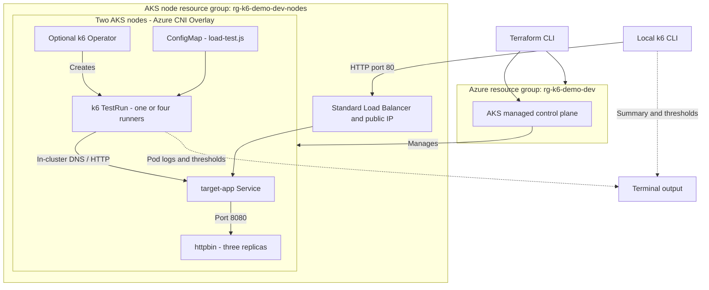

# Load Testing AKS Applications with k6

Deploy httpbin to AKS and exercise HTTP behavior with local or distributed k6 load tests.

## What you'll deploy

- Terraform-managed resource group and AKS cluster with two nodes, managed identity, Azure CNI Overlay, and a Standard Load Balancer.
- A custom AKS node resource group named `rg-k6-demo-dev-nodes` by default.
- Three replicas of go-httpbin exposed by a Kubernetes `LoadBalancer` service.
- Selectable smoke, load, spike, and failure-path tests with checks, isolated thresholds, and custom metrics.
- Optionally, the official Grafana k6 Operator to run the test from inside AKS.

## Architecture



Terraform owns the Azure resources. Kubernetes creates the sample Service's public IP and load-balancer rules in the node resource group. `deploy.sh` installs httpbin after provisioning; the operator is a separate, optional Helm installation. No private container registry or application build is required: the deployment uses the pinned, multi-architecture `ghcr.io/mccutchen/go-httpbin:2.26.0` image, running as non-root with a read-only filesystem. Responses are limited to 1 MiB and delays to five seconds; redirects are restricted to `example.com`.

## Files

| Path | Purpose |
| --- | --- |
| `terraform/` | AKS, resource group, variables, outputs, and example configuration |
| `deploy.sh` | Provision infrastructure, fetch kubeconfig, and deploy the sample API |
| `cleanup.sh` | Destroy infrastructure, verify resource groups are gone, and remove local state/cache |
| `k8s/target-app.yaml` | httpbin Deployment and Service; probes use `/status/200` |
| `k8s/k6-test-run.yaml` | Optional distributed operator test |
| `k6/load-test.js` | Shared script with selectable smoke/load/spike/failure profiles |

## Prerequisites

- An Azure subscription with permission to create resource groups, AKS, and its managed networking resources. Register `Microsoft.ContainerService`, `Microsoft.Compute`, and `Microsoft.Network` if needed.
- Azure CLI, Terraform >= 1.6, and `kubectl`.
- Regional quota and VM availability for two `Standard_D2s_v5` nodes (four vCPUs), plus one temporary node during upgrades.
- [k6](https://grafana.com/docs/k6/latest/set-up/install-k6/) for local execution.
- [Helm](https://helm.sh/docs/intro/install/) for the optional k6 Operator.

## Provision infrastructure and deploy

Run from this demo directory:

```bash
cd AKS-K6-Load-Testing
az login
az account set --subscription "<subscription-id>"
cp terraform/terraform.tfvars.example terraform/terraform.tfvars
bash deploy.sh
```

Edit `terraform/terraform.tfvars` before deploying to change the region, cluster names, VM size, or node count. If deploying multiple copies, give each resource group, cluster, and node resource group a unique name. Kubernetes defaults to the region's supported version unless `kubernetes_version` is set. Following the other demo scripts, the script reads the active Azure subscription, runs Terraform init/validate/apply with automatic approval, configures kubeconfig, and waits for the API rollout. Use the Terraform-only workflow below to review a plan and approve changes interactively. It can be rerun after a failure without recreating existing resources.

Terraform-only provisioning is also available:

```bash
export TF_VAR_subscription_id="$(az account show --query id -o tsv)"
terraform -chdir=terraform init
terraform -chdir=terraform validate
terraform -chdir=terraform plan
terraform -chdir=terraform apply
az aks get-credentials \
  --resource-group "$(terraform -chdir=terraform output -raw resource_group_name)" \
  --name "$(terraform -chdir=terraform output -raw cluster_name)" \
  --overwrite-existing
```

`terraform/terraform.tfvars`, state, and provider cache are gitignored. Do not commit subscription IDs, kubeconfig, credentials, or Terraform state. Use a secured remote state backend for shared or production environments.

### Use an existing cluster instead

Skip Terraform and `deploy.sh` if you already have a cluster. Verify `kubectl config current-context` points to the intended cluster, then deploy only the sample API:

```bash
kubectl create namespace k6-demo --dry-run=client -o yaml | kubectl apply -f -
kubectl apply -f k8s/target-app.yaml
kubectl rollout status deployment/target-app -n k6-demo
kubectl get service target-app -n k6-demo
```

If upgrading from this demo's earlier Node.js target, reapply `k8s/target-app.yaml`, wait for the rollout above, then remove its unused source ConfigMap with `kubectl delete configmap target-app -n k6-demo --ignore-not-found`. The Deployment and Service names stay unchanged.

The service is a public Azure Load Balancer. Wait for `EXTERNAL-IP` to be assigned before running the local test. To avoid public exposure, change the service type to `ClusterIP` and use `kubectl port-forward service/target-app 8080:80 -n k6-demo` instead.

## Option A: Run k6 locally

### 1. Verify the target and choose an address

Run all commands below from `AKS-K6-Load-Testing`. Check that your Kubernetes context is the intended cluster:

```bash
kubectl config current-context
kubectl rollout status deployment/target-app -n k6-demo --timeout=300s
kubectl get service target-app -n k6-demo
```

Wait for an external IP instead of `<pending>`, then set it in the terminal where k6 will run:

```bash
export BASE_URL="http://<EXTERNAL-IP>"
curl --fail "$BASE_URL/status/200"
```

Alternatively, use a port-forward. Start it in a separate terminal and leave it running:

```bash
kubectl port-forward service/target-app 8080:80 -n k6-demo
```

In your k6 terminal, set `export BASE_URL="http://localhost:8080"`. Changing the Service to `ClusterIP` before applying the manifest avoids public exposure. Port-forwarding is suitable for functional checks, not representative throughput measurements.

### 2. Start with smoke, then run the other profiles

```bash
TEST_TYPE=smoke k6 run k6/load-test.js
TEST_TYPE=load k6 run k6/load-test.js
TEST_TYPE=spike k6 run k6/load-test.js
TEST_TYPE=failure k6 run k6/load-test.js
```

Run them sequentially so they do not compete with each other. `TEST_TYPE` defaults to `load`. Only test infrastructure you own or are authorized to load test; do not point these profiles at a public httpbin service.

| Profile | Traffic shape | Requests per iteration |
| --- | --- | --- |
| `smoke` | 1 VU for 10 seconds | Normal mixed traffic |
| `load` | 0 to 5 VUs over 30s, to 20 over 1m, hold 2m, ramp down 30s | Normal mixed traffic |
| `spike` | 1 to 5 VUs over 10s, to 50 over 10s, hold 30s, ramp down 10s | Normal mixed traffic |
| `failure` | 2 VUs for 20 seconds | Normal mixed traffic plus errors, delays, and a deliberate timeout |

VU means virtual user. Each iteration sleeps for one second; requests within an iteration are sequential, not a fixed requests-per-second schedule. Runs allow up to 10 seconds for in-flight iterations to finish. The spike is deliberately demanding and may breach thresholds on the small demo node pool.

### 3. Understand endpoint coverage and results

| Endpoint | Validation | Profiles |
| --- | --- | --- |
| `GET /get?scenario=mixed` | HTTP 200 and echoed request URL | All |
| `POST /post` | HTTP 200 and echoed JSON body | All |
| `/bytes/1024`, `/bytes/65536` | Exact 1 KiB and 64 KiB response sizes | All |
| `/basic-auth/demo/secret` with valid credentials | HTTP 200 and authenticated response | All |
| `/status/404`, `/status/500` | Exactly the requested error status | `failure` |
| `/basic-auth/demo/secret` with invalid credentials | Exactly HTTP 401 | `failure` |
| `/delay/1` | HTTP 200, at least 1s duration, p95 below 3s | `failure` |
| `/delay/2` with a 500 ms client timeout | Timeout error code 1050 and no HTTP response | `failure` |

The `demo:secret` credentials are public test values, not real authentication secrets. Do not send real credentials to this HTTP endpoint.

The terminal summary shows checks and thresholds. All profiles require more than 99% of checks to pass, less than 1% unexpected normal-request failures, and `normal_latency` p95 below 200 ms. A threshold breach makes k6 exit nonzero. Read the summary and capture the exit code immediately after a run with `echo $?`.

If Internet round trips exceed the normal latency budget, explicitly choose a suitable budget rather than changing the failure/delay thresholds:

```bash
TEST_TYPE=smoke NORMAL_P95_MS=500 k6 run k6/load-test.js
```

The failure profile uses per-request expected statuses: expected 401/404/500 responses must match exactly and must not count as unexpected HTTP failures. Delays have their own threshold. Deliberate timeouts produce `Request Failed` warnings and make the aggregate `http_req_failed` nonzero; this is expected. The tagged timeout metric must exceed 99%, and the timeout check must pass. There is no global latency or failure-rate threshold mixing these categories together.

### 4. Save a local result summary

```bash
TEST_TYPE=load k6 run --summary-export=load-summary.json k6/load-test.js
```

This creates a local aggregate JSON summary, not a time-series dashboard. Do not commit generated result files.

## Option B: Run with the k6 Operator

### 1. Install and verify the operator

The operator runs k6 pods inside the cluster; local k6 installation is not required for this path. Check your Kubernetes context first, then install the official chart:

```bash
helm repo add grafana https://grafana.github.io/helm-charts
helm repo update
helm upgrade --install k6-operator grafana/k6-operator \
  --namespace k6-operator-system \
  --create-namespace --wait --timeout 5m
kubectl wait --for=condition=Established crd/testruns.k6.io --timeout=60s
kubectl get deployments,pods -n k6-operator-system
```

### 2. Upload the shared test script

Run from the demo directory. Repeat this step whenever the JavaScript changes, before starting a new test:

```bash
kubectl create configmap k6-test-script \
  --from-file=test.js=k6/load-test.js \
  --namespace k6-demo \
  --dry-run=client -o yaml | kubectl apply -f -
```

### 3. Select a profile and create a TestRun

Start with `smoke`. For later runs, change the first line to `load`, `spike`, or `failure`, then rerun this block:

```bash
TEST_TYPE=smoke
case "$TEST_TYPE" in
  smoke|failure) PARALLELISM=1 ;;
  load|spike) PARALLELISM=4 ;;
  *) printf 'Unknown test profile\n'; exit 1 ;;
esac
RUN_NAME="httpbin-$TEST_TYPE"

kubectl patch --local -f k8s/k6-test-run.yaml --type=merge \
  -p "{\"metadata\":{\"name\":\"$RUN_NAME\"},\"spec\":{\"parallelism\":$PARALLELISM,\"runner\":{\"env\":[{\"name\":\"TEST_TYPE\",\"value\":\"$TEST_TYPE\"}]}}}" \
  -o yaml | kubectl apply -f -
```

This renders a named TestRun without modifying the checked-in template. Smoke/failure use one runner because their maximum VUs are only one/two. Load/spike use four runners; k6 splits the configured total VUs across runners, rather than running the full VU count on each pod. Thresholds and summaries are evaluated per runner, not as a single merged percentile.

The runners use `http://target-app.k6-demo.svc.cluster.local`; do not pass your local port-forward URL or a public httpbin address. `BASE_URL` exported in your terminal does not automatically propagate to runner pods. The template's `spec.runner.env` explicitly selects the profile. With no separate `spec.initializer` configured, the initializer inherits these settings when archiving/inspecting the script, so it sees the same VU configuration as the runners. Add `NORMAL_P95_MS` to `spec.runner.env` too if you deliberately want a different normal-request latency budget.

For the default four-runner load profile only, the unmodified template also works:

```bash
kubectl apply -f k8s/k6-test-run.yaml
```

Its name is `distributed-load-test`, not `httpbin-load`; use that name when inspecting or deleting it. Avoid running both simultaneously.

### 4. Watch execution and inspect results

```bash
kubectl get testrun "$RUN_NAME" -n k6-demo -w
```

Use Ctrl+C to stop watching; it does not cancel the test. In another terminal, set `RUN_NAME` to the same name and inspect the run:

```bash
RUN_NAME=httpbin-smoke
kubectl describe testrun "$RUN_NAME" -n k6-demo
kubectl get jobs,pods -n k6-demo
```

Find the initializer, starter, and runner pods belonging to that run. Initializer pods inspect/archive the script; starter pods coordinate execution. Read **each runner's** logs for its k6 checks and thresholds:

```bash
kubectl logs -n k6-demo <runner-pod-name> --all-containers=true
kubectl get pod <runner-pod-name> -n k6-demo \
  -o jsonpath='{range .status.containerStatuses[*]}{.name}{": exit="}{.state.terminated.exitCode}{"\n"}{end}'
```

`kubectl apply` succeeding means the test was submitted, not that its thresholds passed. Check all runner logs and exit codes; threshold failures produce nonzero exits. If a run stalls, use `kubectl describe pod <pod-name> -n k6-demo`, initializer logs, and operator logs (`kubectl logs -n k6-operator-system deployment/<operator-deployment-name> --all-containers=true`). Look for image pull errors, insufficient CPU/memory, script errors, or missing ConfigMaps.

### 5. Rerun or cancel a profile

A completed TestRun does not restart just because you apply it again. Save its runner logs, then delete it and rerun step 3:

```bash
kubectl delete testrun "$RUN_NAME" -n k6-demo --ignore-not-found --wait=true
```

Deleting an active TestRun cancels its managed jobs/pods. Run one profile at a time; leave the operator and ConfigMap installed for subsequent runs.

## Metrics and observability

Managed Prometheus, Log Analytics, and Managed Grafana are **not provisioned** by this demo. The default experience is the local k6 summary or operator runner logs.

The local run prints the standard k6 summary, including tagged thresholds, the `normal_latency` Trend, and (for the failure profile) the `expected_error_responses` Counter. To send metrics to a Prometheus-compatible remote-write endpoint, configure its endpoint and authentication and run:

```bash
BASE_URL="http://<EXTERNAL-IP>" \
K6_PROMETHEUS_RW_SERVER_URL="<remote-write-endpoint>" \
  k6 run --out experimental-prometheus-rw k6/load-test.js
```

For Azure Monitor Managed Prometheus, configure the supported remote-write ingestion endpoint and Azure authentication for the runner, then view the workspace as a data source in Azure Managed Grafana. Do not put credentials in the manifests. The operator runners need the same remote-write output configuration; the default manifests only show the k6 CLI summary.

## Costs and demo limitations

The AKS Free tier has no control-plane SLA; nodes, disks, public IPs, load balancing, and outbound traffic still incur charges until destroyed. No paid monitoring services are enabled by default. Check regional pricing and clean up after testing.

The API is deliberately exposed over unauthenticated public HTTP. Do not use real data or treat this as a production deployment. The control-plane endpoint is public and kubeconfig grants cluster access; protect it. For private API testing, use the `ClusterIP`/port-forward alternative described above. Local latency includes Internet round trips, so the 200 ms threshold can fail from distant clients. Distributed runners share nodes with the target app and compete for CPU/memory; use dedicated load-generator nodes for representative performance testing.

## Clean up

### Cluster created by this demo

```bash
bash cleanup.sh
```

The script asks `Continue? (y/N)` before running `terraform destroy -auto-approve`, removes the cluster and both resource groups (including its workloads, managed disks, load balancer, and public IPs), verifies both groups are absent in Azure, then removes the kubeconfig context/cluster entries, local state, and `.terraform/`. If deletion or verification fails, state is retained for recovery: fix the error and rerun cleanup. If provisioning failed before Terraform produced outputs, run `terraform -chdir=terraform destroy` directly and verify resource deletion before removing local state/cache.

### Existing cluster: remove demo resources only

Do **not** run `cleanup.sh` against an existing/shared cluster. Check your Kubernetes context, then run:

```bash
kubectl delete -f k8s/k6-test-run.yaml --ignore-not-found
kubectl delete testrun httpbin-smoke httpbin-load httpbin-spike httpbin-failure \
  -n k6-demo --ignore-not-found
kubectl delete namespace k6-demo
helm uninstall k6-operator --namespace k6-operator-system
kubectl delete namespace k6-operator-system
```

Deleting the `k6-demo` namespace removes the sample API, service, and test ConfigMap, including the Service's Azure load-balancer rules/public IP. Only uninstall the operator if you installed it for this demo and no other tests depend on it. Helm may retain its cluster-scoped CRDs; do not delete those on a shared cluster without checking other users.

## References

- [AKS with Terraform](https://learn.microsoft.com/azure/aks/learn/quick-kubernetes-deploy-terraform)
- [AzureRM AKS resource](https://registry.terraform.io/providers/hashicorp/azurerm/latest/docs/resources/kubernetes_cluster)
- [Grafana k6 Operator](https://grafana.com/docs/k6/latest/set-up/set-up-distributed-k6/)
- [go-httpbin image, configuration, and endpoints](https://github.com/mccutchen/go-httpbin)
- [k6 expected HTTP statuses](https://grafana.com/docs/k6/latest/javascript-api/k6-http/expected-statuses/)
