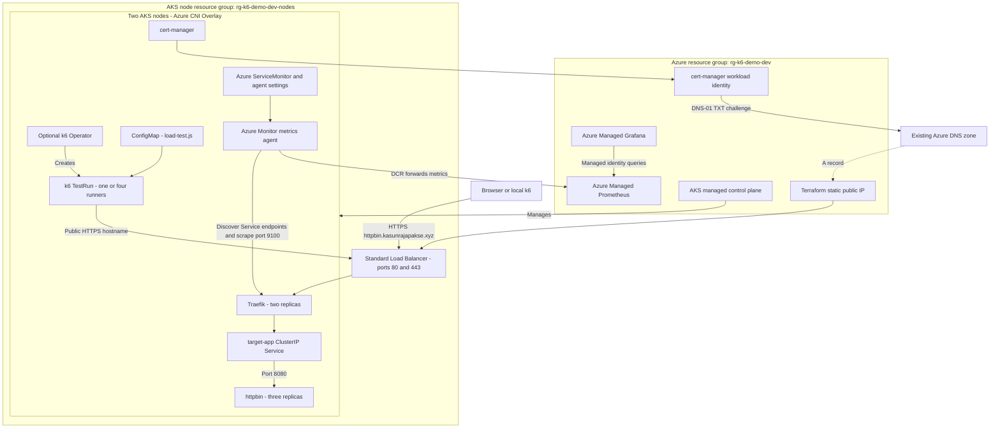

# Load Testing AKS Applications with k6

Load test httpbin through Traefik HTTPS ingress on AKS with Azure DNS, managed Prometheus, and Grafana.

## What you'll deploy

- Terraform-managed resource group and AKS cluster with two nodes, managed identity, Azure CNI Overlay, and a Standard Load Balancer.
- A custom AKS node resource group named `rg-k6-demo-dev-nodes` by default.
- Three replicas of go-httpbin behind a `ClusterIP` Service and a two-replica Traefik ingress controller.
- `https://httpbin.kasunrajapakse.xyz`, a Terraform-owned static public IP and A record in the **existing** `kasunrajapakse.xyz` zone in `rg-dns-zones`.
- Let's Encrypt TLS using cert-manager with Azure DNS DNS-01 and workload identity, not a client secret.
- Azure managed Prometheus and Managed Grafana, with the Azure-specific ServiceMonitor and an automatically imported Traefik dashboard.
- Selectable smoke, load, spike, and failure-path tests with checks, isolated thresholds, and custom metrics.
- A separate, more aggressive fixed-rate stress test with automatic abort on high error rates.
- Optionally, the official Grafana k6 Operator to run the test from inside AKS.

## Architecture



Terraform owns the demo's Azure resources and `httpbin` A record, but the existing DNS zone is only a data source: it is never created or deleted. The static IP is in the demo resource group; AKS attaches it to Traefik's load-balancer Service through Azure annotations and the cluster identity's Network Contributor role. The node resource group contains the managed load balancer and nodes. Teardown removes AKS before releasing the public IP.

`deploy.sh` installs httpbin, Traefik chart `42.0.0`, and cert-manager chart `v1.21.2`; waits for a valid certificate; applies Azure Monitor settings and the Azure-specific ServiceMonitor; then imports the official Traefik dashboard from Grafana.com. The k6 Operator remains optional. httpbin uses `ghcr.io/mccutchen/go-httpbin:2.26.0` as non-root with a read-only filesystem. Responses are limited to 1 MiB, delays to five seconds, and redirects to `example.com`. Traefik's admin dashboard and metrics port are not exposed publicly.

## Files

| Path | Purpose |
| --- | --- |
| `terraform/` | AKS, static IP, existing-zone DNS record, identities, Prometheus, and Grafana |
| `deploy.sh` | Provision infrastructure, install ingress/TLS, configure monitoring, and import the dashboard |
| `cleanup.sh` | Destroy infrastructure, verify groups/DNS record removal, and remove local state/cache |
| `k8s/target-app.yaml` | httpbin Deployment and Service; probes use `/status/200` |
| `k8s/traefik-values.yaml.tpl` | Static ingress IP, HTTPS redirect, metrics, and replica settings |
| `k8s/httpbin-ingress.yaml.tpl` | Azure DNS ClusterIssuer, Certificate, and HTTPS Ingress |
| `k8s/k6-test-run.yaml` | Optional distributed operator test |
| `k8s/k6-stress-test-run.yaml` | Optional distributed operator stress test |
| `k8s/k6-slo-breach-test-run.yaml` | Operator test generating sustained 300 ms and 1200 ms latency breaches |
| `monitoring/ama-metrics-settings-configmap-v2.yaml` | Schema-v2 Azure Monitor metrics agent settings |
| `monitoring/traefik-azure-monitor-servicemonitor.yaml` | Azure-specific ServiceMonitor selecting Traefik's metrics Service |
| `k6/load-test.js` | Shared script with selectable smoke/load/spike/failure profiles |
| `k6/stress-test.js` | Aggressive fixed-rate stress test that ramps up to `PEAK_RPS` requests per second |
| `k6/slo-breach-test.js` | Low-rate delayed requests to populate the Traefik SLO tiles |

## Prerequisites

- An Azure subscription with permission to create resource groups, AKS, managed Prometheus/Grafana, and role assignments (for example Contributor plus User Access Administrator at the appropriate scopes). Register `Microsoft.ContainerService`, `Microsoft.Compute`, `Microsoft.Network`, `Microsoft.Monitor`, `Microsoft.Insights`, `Microsoft.Dashboard`, and `Microsoft.ManagedIdentity` if needed.
- The existing, publicly delegated Azure DNS zone `kasunrajapakse.xyz` in `rg-dns-zones`, in the same subscription. The deployer must be able to read the zone, manage the demo A record, and assign DNS Zone Contributor to cert-manager's identity.
- Azure CLI >= 2.75 with the `amg` extension, Terraform >= 1.6, `kubectl`, Helm, `curl`, and `envsubst` (from gettext; on macOS: `brew install gettext`). Helm is required for ingress/TLS even without the operator.
- Regional quota and VM availability for two `Standard_D2s_v5` nodes (four vCPUs), plus one temporary node during upgrades.
- [k6](https://grafana.com/docs/k6/latest/set-up/install-k6/) for local execution.
- Kubernetes >= 1.30 for the pinned Traefik chart. Leave `kubernetes_version` unset for the AKS regional default, or explicitly choose a supported compatible version.

## Provision infrastructure and deploy

Run from this demo directory:

```bash
cd AKS-K6-Load-Testing
az login
az account set --subscription "<subscription-id>"
az extension add --name amg
cp terraform/terraform.tfvars.example terraform/terraform.tfvars
bash deploy.sh
```

Edit `terraform/terraform.tfvars` before deploying to change the region, resource names, VM size, or node count. The configured hostname is `httpbin.kasunrajapakse.xyz`, with ACME contact `contact@kasunrajapakse.xyz`. Multiple copies need unique resource group/cluster/node-group names **and a unique subdomain**; update `BASE_URL` in `k8s/k6-test-run.yaml` if changing the hostname. Never overwrite a DNS record used by another demo. If the requested record already exists outside Terraform, deliberately import it or choose another subdomain rather than deleting it blindly.

The script detects the active subscription and signed-in user's Entra object ID, provisions with automatic approval, installs ingress/TLS, waits up to 15 minutes for certificate readiness, and imports the Grafana dashboard. That caller receives Grafana Admin; Grafana's managed identity receives Monitoring Data Reader on the Prometheus workspace. If signed-in-user lookup is unavailable, set `TF_VAR_grafana_admin_object_id` to the Azure CLI caller's Entra **object ID**, not its application/client ID. If setting `grafana_admin_object_id` in tfvars, the CLI caller must be that principal or already have Grafana Admin.

Rerun `bash deploy.sh` after a recoverable failure: it updates existing resources and imports the same dashboard UID. The final summary prints application and Grafana links. Open `https://httpbin.kasunrajapakse.xyz/` for the endpoint explorer, `/get` for echoed request details, or `/status/200` to verify access. HTTP redirects to HTTPS. Keep Terraform state for cleanup.

Terraform-only provisioning is also available:

```bash
export TF_VAR_subscription_id="$(az account show --query id -o tsv)"
export TF_VAR_grafana_admin_object_id="$(az ad signed-in-user show --query id -o tsv)"
terraform -chdir=terraform init
terraform -chdir=terraform validate
terraform -chdir=terraform plan
terraform -chdir=terraform apply
az aks get-credentials \
  --resource-group "$(terraform -chdir=terraform output -raw resource_group_name)" \
  --name "$(terraform -chdir=terraform output -raw cluster_name)" \
  --overwrite-existing
```

Terraform-only commands provision Azure resources, not Helm releases, certificates, ServiceMonitors, or dashboards. Run `bash deploy.sh` afterward to finish those steps. `terraform/terraform.tfvars`, state, and provider cache are gitignored. Do not commit subscription IDs, kubeconfig, credentials, or state; use a secured remote backend for shared or production environments.

### Use an existing cluster instead

Skip Terraform and `deploy.sh` if you already have a cluster. Verify `kubectl config current-context` points to the intended cluster, then deploy only httpbin:

```bash
kubectl create namespace k6-demo --dry-run=client -o yaml | kubectl apply -f -
kubectl apply -f k8s/target-app.yaml
kubectl rollout status deployment/target-app -n k6-demo
kubectl get service target-app -n k6-demo
```

This existing-cluster path deploys only a ClusterIP backend. Use port-forwarding below for local tests, or set operator `BASE_URL` to `http://target-app.k6-demo.svc.cluster.local`. It does not install ingress/TLS or provision monitoring. Do not use `deploy.sh` to attach resources to an arbitrary shared cluster: it owns a new cluster through Terraform.

## Option A: Run k6 locally

### 1. Verify the target and choose an address

Run all commands below from `AKS-K6-Load-Testing`. Check that your Kubernetes context is the intended cluster:

```bash
kubectl config current-context
kubectl rollout status deployment/target-app -n k6-demo --timeout=300s
kubectl get service target-app -n k6-demo
```

For the full deployment, verify the certificate/Ingress and use the public HTTPS hostname:

```bash
kubectl get ingress,certificate -n k6-demo
export BASE_URL="https://httpbin.kasunrajapakse.xyz"
curl --fail "$BASE_URL/status/200"
```

Alternatively, use a port-forward. Start it in a separate terminal and leave it running:

```bash
kubectl port-forward service/target-app 8080:80 -n k6-demo
```

In your k6 terminal, set `export BASE_URL="http://localhost:8080"`. Port-forwarding bypasses Traefik: it will not generate ingress dashboard metrics and is suitable for functional checks, not representative throughput measurements.

### 2. Start with smoke, then run the other profiles

```bash
TEST_TYPE=smoke k6 run k6/load-test.js
TEST_TYPE=load k6 run k6/load-test.js
TEST_TYPE=spike k6 run k6/load-test.js
TEST_TYPE=failure k6 run k6/load-test.js
```

Run them sequentially so they do not compete with each other. `TEST_TYPE` defaults to `load`. Only test infrastructure you own or are authorized to load test; do not point these profiles at a public httpbin service.

| Profile | Traffic shape | Requests per iteration |
| --- | --- | --- |
| `smoke` | 1 VU for 10 seconds | Normal mixed traffic |
| `load` | 0 to 5 VUs over 30s, to 20 over 1m, hold 2m, ramp down 30s | Normal mixed traffic |
| `spike` | 1 to 5 VUs over 10s, to 50 over 10s, hold 30s, ramp down 10s | Normal mixed traffic |
| `failure` | 2 VUs for 20 seconds | Normal mixed traffic plus errors, delays, and a deliberate timeout |

VU means virtual user. Each iteration sleeps for one second; requests within an iteration are sequential, not a fixed requests-per-second schedule. Runs allow up to 10 seconds for in-flight iterations to finish. The spike is deliberately demanding and may breach thresholds on the small demo node pool.

### 3. Understand endpoint coverage and results

| Endpoint | Validation | Profiles |
| --- | --- | --- |
| `GET /get?scenario=mixed` | HTTP 200 and echoed request URL | All |
| `POST /post` | HTTP 200 and echoed JSON body | All |
| `/bytes/1024`, `/bytes/65536` | Exact 1 KiB and 64 KiB response sizes | All |
| `/basic-auth/demo/secret` with valid credentials | HTTP 200 and authenticated response | All |
| `/status/404`, `/status/500` | Exactly the requested error status | `failure` |
| `/basic-auth/demo/secret` with invalid credentials | Exactly HTTP 401 | `failure` |
| `/delay/1` | HTTP 200, at least 1s duration, p95 below 3s | `failure` |
| `/delay/2` with a 500 ms client timeout | Timeout error code 1050 and no HTTP response | `failure` |

The `demo:secret` credentials are public test values, not real authentication secrets. Never send real credentials or sensitive data to this demo, even over HTTPS: httpbin deliberately echoes request data.

The terminal summary shows checks and thresholds. All profiles require more than 99% of checks to pass, less than 1% unexpected normal-request failures, and `normal_latency` p95 below 200 ms. A threshold breach makes k6 exit nonzero. Read the summary and capture the exit code immediately after a run with `echo $?`.

If Internet round trips exceed the normal latency budget, explicitly choose a suitable budget rather than changing the failure/delay thresholds:

```bash
TEST_TYPE=smoke NORMAL_P95_MS=500 k6 run k6/load-test.js
```

The failure profile uses per-request expected statuses: expected 401/404/500 responses must match exactly and must not count as unexpected HTTP failures. Delays have their own threshold. Deliberate timeouts produce `Request Failed` warnings and make the aggregate `http_req_failed` nonzero; this is expected. The tagged timeout metric must exceed 99%, and the timeout check must pass. There is no global latency or failure-rate threshold mixing these categories together.

### 4. Save a local result summary

```bash
TEST_TYPE=load k6 run --summary-export=load-summary.json k6/load-test.js
```

This creates a local aggregate JSON summary, not a time-series dashboard. Do not commit generated result files.

## Option B: Run with the k6 Operator

### 1. Install and verify the operator

The operator runs k6 pods inside the cluster; local k6 installation is not required for this path. Check your Kubernetes context first, then install the official chart:

```bash
helm repo add grafana https://grafana.github.io/helm-charts
helm repo update
helm upgrade --install k6-operator grafana/k6-operator \
  --namespace k6-operator-system \
  --create-namespace --wait --timeout 5m
kubectl wait --for=condition=Established crd/testruns.k6.io --timeout=60s
kubectl get deployments,pods -n k6-operator-system
```

### 2. Upload the shared test script

Run from the demo directory. Repeat this step whenever the JavaScript changes, before starting a new test:

```bash
kubectl create configmap k6-test-script \
  --from-file=test.js=k6/load-test.js \
  --namespace k6-demo \
  --dry-run=client -o yaml | kubectl apply -f -
```

### 3. Select a profile and create a TestRun

Start with `smoke`. For later runs, change the first line to `load`, `spike`, or `failure`, then rerun this block:

```bash
TEST_TYPE=smoke
HTTPBIN_BASE_URL="https://httpbin.kasunrajapakse.xyz"
case "$TEST_TYPE" in
  smoke|failure) PARALLELISM=1 ;;
  load|spike) PARALLELISM=4 ;;
  *) printf 'Unknown test profile\n'; exit 1 ;;
esac
RUN_NAME="httpbin-$TEST_TYPE"

kubectl patch --local -f k8s/k6-test-run.yaml --type=merge \
  -p "{\"metadata\":{\"name\":\"$RUN_NAME\"},\"spec\":{\"parallelism\":$PARALLELISM,\"runner\":{\"env\":[{\"name\":\"TEST_TYPE\",\"value\":\"$TEST_TYPE\"},{\"name\":\"BASE_URL\",\"value\":\"$HTTPBIN_BASE_URL\"}]}}}" \
  -o yaml | kubectl apply -f -
```

This renders a named TestRun without modifying the checked-in template. Smoke/failure use one runner because their maximum VUs are only one/two. Load/spike use four runners; k6 splits the configured total VUs across runners, rather than running the full VU count on each pod. Thresholds and summaries are evaluated per runner, not as a single merged percentile.

The template and commands use `https://httpbin.kasunrajapakse.xyz`, so traffic crosses Traefik and appears in Grafana. Never pass a local port-forward URL or someone else's public httpbin service. For a backend-only comparison, use `HTTPBIN_BASE_URL="http://target-app.k6-demo.svc.cluster.local"`; it bypasses TLS/Traefik and does not populate the ingress dashboard.

Local environment variables do not automatically propagate to pods: the patch explicitly supplies `BASE_URL` in `spec.runner.env`. With no separate `spec.initializer`, the initializer inherits those settings and sees the same profile. Add `NORMAL_P95_MS` to `spec.runner.env` too if deliberately choosing a different latency budget.

For the default four-runner load profile only, the unmodified template also works:

```bash
kubectl apply -f k8s/k6-test-run.yaml
```

Its name is `distributed-load-test`, not `httpbin-load`; use that name when inspecting or deleting it. Avoid running both simultaneously.

### 4. Watch execution and inspect results

```bash
kubectl get testrun "$RUN_NAME" -n k6-demo -w
```

Use Ctrl+C to stop watching; it does not cancel the test. In another terminal, set `RUN_NAME` to the same name and inspect the run:

```bash
RUN_NAME=httpbin-smoke
kubectl describe testrun "$RUN_NAME" -n k6-demo
kubectl get jobs,pods -n k6-demo
```

Find the initializer, starter, and runner pods belonging to that run. Initializer pods inspect/archive the script; starter pods coordinate execution. Read **each runner's** logs for its k6 checks and thresholds:

```bash
kubectl logs -n k6-demo <runner-pod-name> --all-containers=true
kubectl get pod <runner-pod-name> -n k6-demo \
  -o jsonpath='{range .status.containerStatuses[*]}{.name}{": exit="}{.state.terminated.exitCode}{"\n"}{end}'
```

`kubectl apply` succeeding means the test was submitted, not that its thresholds passed. Check all runner logs and exit codes; threshold failures produce nonzero exits. If a run stalls, use `kubectl describe pod <pod-name> -n k6-demo`, initializer logs, and operator logs (`kubectl logs -n k6-operator-system deployment/<operator-deployment-name> --all-containers=true`). Look for image pull errors, insufficient CPU/memory, script errors, or missing ConfigMaps.

### 5. Rerun or cancel a profile

A completed TestRun does not restart just because you apply it again. Save its runner logs, then delete it and rerun step 3:

```bash
kubectl delete testrun "$RUN_NAME" -n k6-demo --ignore-not-found --wait=true
```

Deleting an active TestRun cancels its managed jobs/pods. Run one profile at a time; leave the operator and ConfigMap installed for subsequent runs.

## Option C: Stress test

`k6/stress-test.js` is a separate, more aggressive test. The profiles above use virtual users that wait for each response and sleep for a second, so they slow down when the server slows down. The stress test uses k6's `ramping-arrival-rate` executor instead: it starts new requests at a fixed rate whether or not earlier ones have finished, so a struggling server sees growing pressure rather than relief. Use it to find where httpbin and Traefik start to degrade, and watch the Traefik dashboard while it runs.

| Stage | Duration | Target requests per second |
| --- | --- | --- |
| Warm-up | 1m | 25% of `PEAK_RPS` |
| Ramp | 2m | 50% of `PEAK_RPS` |
| Ramp | 2m | `PEAK_RPS` |
| Sustain | 3m | `PEAK_RPS` |
| Ramp down | 1m | 0 |

`PEAK_RPS` defaults to 300. Each iteration is one request: 50% `GET /get`, 20% `POST /post`, 20% `/bytes/1024`, and 10% `/bytes/65536`. Response bodies are discarded to keep the load generator light, so the checks only verify HTTP 200.

| Threshold | Meaning |
| --- | --- |
| `http_req_failed` rate < 5% | The test **aborts automatically** once errors pass 5%, evaluated after the first minute |
| `http_req_duration` p95 < 500 ms, p99 < 1.5 s | Latency stays acceptable under load |
| `checks` rate > 95% | Requests return HTTP 200 |
| `dropped_iterations` rate < 1/s | k6 could keep up with the target rate; dropped iterations mean every virtual user was stuck waiting on slow responses |

The test requires `BASE_URL` and has no default, so it can't be pointed at the wrong target by accident. Only run it against infrastructure you own.

### Run locally

```bash
BASE_URL="https://httpbin.kasunrajapakse.xyz" k6 run k6/stress-test.js
BASE_URL="https://httpbin.kasunrajapakse.xyz" PEAK_RPS=500 k6 run k6/stress-test.js
```

From a laptop, your own bandwidth and connection may become the bottleneck before the cluster does. If `dropped_iterations` climbs while server-side latency in Grafana stays flat, the load generator is the limit; use the operator instead.

### Run with the k6 Operator

```bash
HTTPBIN_BASE_URL="https://httpbin.kasunrajapakse.xyz"
PEAK_RPS=300

kubectl create configmap k6-stress-script \
  --from-file=stress.js=k6/stress-test.js \
  --namespace k6-demo \
  --dry-run=client -o yaml | kubectl apply -f -

kubectl patch --local -f k8s/k6-stress-test-run.yaml --type=merge \
  -p "{\"spec\":{\"runner\":{\"env\":[{\"name\":\"BASE_URL\",\"value\":\"$HTTPBIN_BASE_URL\"},{\"name\":\"PEAK_RPS\",\"value\":\"$PEAK_RPS\"}]}}}" \
  -o yaml | kubectl apply -f -

kubectl get testrun httpbin-stress -n k6-demo -w
```

Set `HTTPBIN_BASE_URL` and `PEAK_RPS` before running the block; the patch replaces the manifest's defaults without editing the file. The TestRun uses two runners. With an arrival-rate executor the target rate is split between runners, so each sends half of `PEAK_RPS`. Each runner requests 500m CPU and 256 MiB memory. Inspect results, rerun, and cancel exactly as in Option B steps 4 and 5, using `httpbin-stress` as the run name. Don't run the stress test at the same time as another TestRun.

Expect the default two-node cluster to show stress: httpbin pods are limited to 250m CPU each, and runners share nodes with httpbin and Traefik. Rising latency, Traefik 5xx responses, or an automatic abort are useful results, not test bugs. At peak, about 10% of requests return 64 KiB, so a 300 requests-per-second run sends roughly 2 MB/s of outbound traffic, which Azure bills as egress.

## Option D: Populate the SLO tiles

Use this test to populate **Services failing SLO of 300ms** and **Services failing SLO of 1200ms** in the official Traefik dashboard without overwhelming the cluster. It sends two requests per second to `/delay/0.5` and two per second to `/delay/2` for six minutes. Both return HTTP 200; the ten-second client timeout lets them complete rather than producing intentional 499 client cancellations.

### Run the SLO test locally

```bash
BASE_URL="https://httpbin.kasunrajapakse.xyz" k6 run k6/slo-breach-test.js
```

### Run the SLO test with the operator

```bash
HTTPBIN_BASE_URL="https://httpbin.kasunrajapakse.xyz"
SLO_DURATION="6m"

kubectl create configmap k6-slo-breach-script \
  --from-file=slo-breach.js=k6/slo-breach-test.js \
  --namespace k6-demo \
  --dry-run=client -o yaml | kubectl apply -f -

kubectl patch --local -f k8s/k6-slo-breach-test-run.yaml --type=merge \
  -p "{\"spec\":{\"runner\":{\"env\":[{\"name\":\"BASE_URL\",\"value\":\"$HTTPBIN_BASE_URL\"},{\"name\":\"DURATION\",\"value\":\"$SLO_DURATION\"}]}}}" \
  -o yaml | kubectl apply -f -

kubectl get testrun httpbin-slo-breach -n k6-demo -w
```

This uses one runner. Delete `httpbin-slo-breach` before repeating the operator run, as with the other tests. To cancel, run `kubectl delete testrun httpbin-slo-breach -n k6-demo`.

### View the violations

Run this test by itself. In Grafana, select the httpbin backend (`k6-demo-target-app-80`), **Last 15 minutes**, an **interval of 1m**, and **30s refresh**. Allow several minutes for Azure ingestion and multiple scrapes, then expand the **SLO** row. The 500 ms group breaches only 300 ms; the two-second group breaches both limits. In a steady window containing only this traffic, expect approximately 100% of GET requests above 300 ms and 50% above 1200 ms. Other requests in the same window dilute these percentages.

These panels filter out zero-violation series, so **No data** can mean no violating series in the selected window, not necessarily a collection failure. Traefik must expose histogram buckets `le="0.3"` and `le="1.2"`, which the chart's default buckets provide. The previous failure profile's deliberate 500 ms timeout generates 499s and cannot reliably demonstrate completed requests slower than 1200 ms.

k6 passes when the intended delays occur, HTTP errors stay below 1%, and no iterations are dropped. Its latency thresholds deliberately require p95 **above** the SLO limits; this is a controlled latency-injection demo, not evidence of cluster saturation or a passing production SLO. Do not run it against infrastructure you do not own.

## Metrics and observability

### Azure Monitor metrics collection

The full deployment provisions Managed Prometheus and Grafana; Log Analytics/Container Insights are not included. It applies `ama-metrics-settings-configmap` with **schema v2**, nested cluster/control-plane settings, the minimal ingestion profile, and collector settings. This is an Azure Monitor agent settings ConfigMap, not a self-hosted Prometheus configuration.

Traefik's chart-generated `monitoring.coreos.com/v1` ServiceMonitor is explicitly disabled. Instead, the deployment waits for `servicemonitors.azmonitoring.coreos.com` to be established, then applies `monitoring/traefik-azure-monitor-servicemonitor.yaml` using **`azmonitoring.coreos.com/v1`**. Its selector matches only the internal metrics Service's `azure-monitor-job: traefik` label and its named `metrics` port. The Azure collector discovers individual Service endpoints, scrapes every 30 seconds, and forwards through the DCR to the managed workspace. `jobLabel` sets `job="traefik"` on the scraped series. The label limits are the values Azure's ServiceMonitor templates require so targets aren't dropped.

No OSS Prometheus Operator is needed. On a shared cluster, do not replace global agent settings or delete someone else's custom scrape configuration; the full script is for this Terraform-owned demo cluster.

### Open the imported Traefik dashboard

```bash
terraform -chdir=terraform output -raw grafana_endpoint
```

Open that URL, sign in as the configured Grafana administrator, and select **Dashboards > Traefik Official Kubernetes Dashboard**. The deployment summary prints a direct link (UID `n5bu_kv4k`). The script imports Grafana.com dashboard [17347](https://grafana.com/grafana/dashboards/17347-traefik-official-kubernetes-dashboard/) with `az grafana dashboard import --definition 17347`, binding it to the `Managed_Prometheus_<workspace>` data source that Managed Grafana creates for the linked Azure Monitor workspace. No API key, client secret, or extra data source is used. Manual dashboard changes are overwritten on redeployment.

Run the `load` profile against the HTTPS hostname, select **Last 30 minutes**, and use **30s refresh**. Allow several minutes for configuration reload/ingestion and at least two scrapes for rates. A 10-second smoke test is a functional check, not enough for a sustained throughput graph.

The dashboard shows entrypoint and per-service request rates, HTTP status codes, Apdex, latency, open connections, and request/response bytes; filter with the **entrypoint** and **service** variables. Its Apdex panels use Traefik's default `0.3`/`1.2` second latency buckets, so `k8s/traefik-values.yaml.tpl` keeps the default buckets. The failure profile deliberately produces errors and delays: these appear in Traefik even when k6 passes its expected-behavior checks. Server-side latency is not the same measurement as k6's `normal_latency`, which excludes intentional delays.

### Troubleshoot ingress and metrics

```bash
kubectl get service traefik -n traefik
kubectl get ingress,certificate,certificaterequest,order,challenge -n k6-demo
kubectl describe certificate httpbin-tls -n k6-demo
kubectl logs deployment/cert-manager -n cert-manager --tail=100
kubectl get configmap ama-metrics-settings-configmap -n kube-system -o yaml
kubectl get servicemonitors.azmonitoring.coreos.com -n traefik
kubectl describe servicemonitor.azmonitoring.coreos.com traefik-azure-monitor -n traefik
kubectl logs deployment/ama-metrics -n kube-system --tail=100
```

For certificate failures, verify public DNS delegation, DNS Zone Contributor, and the cert-manager federated identity. For an unassigned ingress IP, inspect Traefik Service events and the cluster identity's Network Contributor role. If dashboard import returns 403, confirm Grafana Admin for the CLI caller, allow RBAC propagation, and rerun `bash deploy.sh`.

If panels are empty, query `up{job="traefik"}` in Grafana Explore. Missing series indicate discovery/ingestion issues; zero means a discovered target cannot be scraped. Verify the Azure ServiceMonitor selector/port, agent settings/logs, DCR association, Grafana's Monitoring Data Reader role, and workspace URL. Inspect raw metrics with `kubectl port-forward -n traefik service/traefik-metrics 9100:9100`, then run `curl --fail http://localhost:9100/metrics` in another terminal. The metrics Service is internal.

### k6 client-side metrics

The Traefik dashboard does not ingest k6 custom metrics. Local summaries and operator runner logs remain the source for client-side checks and thresholds.

The local run prints the standard k6 summary, including tagged thresholds, the `normal_latency` Trend, and (for the failure profile) the `expected_error_responses` Counter. To send metrics to a Prometheus-compatible remote-write endpoint, configure its endpoint and authentication and run:

```bash
BASE_URL="https://httpbin.kasunrajapakse.xyz" \
K6_PROMETHEUS_RW_SERVER_URL="<remote-write-endpoint>" \
  k6 run --out experimental-prometheus-rw k6/load-test.js
```

For Azure Monitor Managed Prometheus, configure the supported remote-write ingestion endpoint and Azure authentication for the runner, then view the workspace as a data source in Azure Managed Grafana. Do not put credentials in the manifests. The operator runners need the same remote-write output configuration; the default manifests only show the k6 CLI summary.

## Costs and demo limitations

The AKS Free tier has no control-plane SLA. Nodes, disks, static public IP, load balancing, DNS queries, outbound traffic, managed Prometheus ingestion/querying, and **Standard Azure Managed Grafana** incur charges until destroyed. Monitoring is enabled by default in this full deployment; it is not free. In-cluster tests through the public hostname use the load-balancer path and may incur network charges. Check regional availability, quotas, and pricing; clean up after testing.

The API is public over HTTPS without access control except its demonstration auth endpoints. HTTP redirects to HTTPS. Do not use real data or treat this as production. The control-plane endpoint is public and kubeconfig grants cluster access; protect it. Port-forwarding bypasses ingress but does not disable the public Ingress. Local latency includes Internet round trips, so the 200 ms threshold can fail from distant clients. Runners share nodes with httpbin, Traefik, and metrics agents; increase capacity for Pending pods or use dedicated load-generator nodes for representative tests.

## Clean up

### Cluster created by this demo

```bash
bash cleanup.sh
```

The script asks `Continue? (y/N)` before destroying the cluster, node/demo resource groups, static IP, Prometheus/Grafana resources, identities/role assignments, and the demo `httpbin` A record. The existing DNS zone, `rg-dns-zones`, and other records remain untouched. It verifies both demo groups and the A record are gone before removing kubeconfig entries, state/backups, and `.terraform/`. Cached DNS answers may persist for the 300-second TTL.

If deletion or verification fails, local state is retained for recovery. If provisioning failed before outputs were created, run `terraform -chdir=terraform destroy` directly and verify Azure deletion before removing local state/cache. If a failed certificate challenge was still active at teardown, inspect this hostname's `_acme-challenge` TXT record for a leftover challenge value; never delete unrelated/shared records.

### Existing cluster: remove demo resources only

Do **not** run `cleanup.sh` against an existing/shared cluster. Check your Kubernetes context, then run:

```bash
kubectl delete -f k8s/k6-test-run.yaml --ignore-not-found
kubectl delete testrun httpbin-smoke httpbin-load httpbin-spike httpbin-failure httpbin-stress httpbin-slo-breach \
  -n k6-demo --ignore-not-found
kubectl delete namespace k6-demo
helm uninstall k6-operator --namespace k6-operator-system
kubectl delete namespace k6-operator-system
```

Deleting `k6-demo` removes the backend and tests, not shared ingress, Azure DNS, or managed monitoring. These commands are for the backend-only existing-cluster path, not a replacement for Terraform cleanup of the full demo. Only uninstall the operator if no other tests depend on it. Helm may retain cluster-scoped CRDs; do not delete those on a shared cluster without checking other users.

## References

- [AKS with Terraform](https://learn.microsoft.com/azure/aks/learn/quick-kubernetes-deploy-terraform)
- [AzureRM AKS resource](https://registry.terraform.io/providers/hashicorp/azurerm/latest/docs/resources/kubernetes_cluster)
- [Grafana k6 Operator](https://grafana.com/docs/k6/latest/set-up/set-up-distributed-k6/)
- [go-httpbin image, configuration, and endpoints](https://github.com/mccutchen/go-httpbin)
- [k6 expected HTTP statuses](https://grafana.com/docs/k6/latest/javascript-api/k6-http/expected-statuses/)
- [cert-manager Azure DNS workload identity](https://cert-manager.io/docs/configuration/acme/dns01/azuredns/)
- [Azure Managed Prometheus ServiceMonitor/PodMonitor CRDs](https://learn.microsoft.com/azure/azure-monitor/containers/prometheus-metrics-scrape-crd)
- [Azure Managed Grafana dashboard import](https://learn.microsoft.com/cli/azure/grafana/dashboard#az-grafana-dashboard-import)
