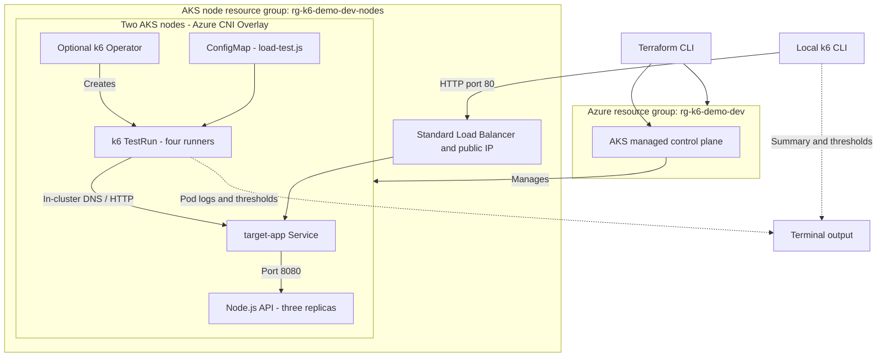

# Load Testing AKS Applications with k6

Deploy a small HTTP API to AKS and load test it locally or in-cluster with the k6 Operator.

## What you'll deploy

- Terraform-managed resource group and AKS cluster with two nodes, managed identity, Azure CNI Overlay, and a Standard Load Balancer.
- A custom AKS node resource group named `rg-k6-demo-dev-nodes` by default.
- A three-replica Node.js HTTP API exposed by a Kubernetes `LoadBalancer` service.
- A k6 test with ramp-up, steady-state, and ramp-down stages, checks, thresholds, and custom metrics.
- Optionally, the official Grafana k6 Operator to run the test from inside AKS.

## Architecture



Terraform owns the Azure resources. Kubernetes creates the sample Service's public IP and load-balancer rules in the node resource group. `deploy.sh` installs the API after provisioning; the operator is a separate, optional Helm installation. No container registry is required: the API uses the public Node.js image and a ConfigMap for its source.

## Files

| Path | Purpose |
| --- | --- |
| `terraform/` | AKS, resource group, variables, outputs, and example configuration |
| `deploy.sh` | Provision infrastructure, fetch kubeconfig, and deploy the sample API |
| `cleanup.sh` | Destroy infrastructure, verify resource groups are gone, and remove local state/cache |
| `k8s/target-app.yaml` | API source ConfigMap, Deployment, and Service |
| `k8s/k6-test-run.yaml` | Optional distributed operator test |
| `k6/load-test.js` | Shared local and distributed load-test script |

## Prerequisites

- An Azure subscription with permission to create resource groups, AKS, and its managed networking resources. Register `Microsoft.ContainerService`, `Microsoft.Compute`, and `Microsoft.Network` if needed.
- Azure CLI, Terraform >= 1.6, and `kubectl`.
- Regional quota and VM availability for two `Standard_D2s_v5` nodes (four vCPUs), plus one temporary node during upgrades.
- [k6](https://grafana.com/docs/k6/latest/set-up/install-k6/) for local execution.
- [Helm](https://helm.sh/docs/intro/install/) for the optional k6 Operator.

## Provision infrastructure and deploy

Run from this demo directory:

```bash
cd AKS-K6-Load-Testing
az login
az account set --subscription "<subscription-id>"
cp terraform/terraform.tfvars.example terraform/terraform.tfvars
bash deploy.sh
```

Edit `terraform/terraform.tfvars` before deploying to change the region, cluster names, VM size, or node count. If deploying multiple copies, give each resource group, cluster, and node resource group a unique name. Kubernetes defaults to the region's supported version unless `kubernetes_version` is set. The script reads the active Azure subscription, runs Terraform init/validate/apply, prompts for approval, configures kubeconfig, and waits for the API rollout. It can be rerun after a failure without recreating existing resources.

Terraform-only provisioning is also available:

```bash
export TF_VAR_subscription_id="$(az account show --query id -o tsv)"
terraform -chdir=terraform init
terraform -chdir=terraform validate
terraform -chdir=terraform plan
terraform -chdir=terraform apply
az aks get-credentials \
  --resource-group "$(terraform -chdir=terraform output -raw resource_group_name)" \
  --name "$(terraform -chdir=terraform output -raw cluster_name)" \
  --overwrite-existing
```

`terraform/terraform.tfvars`, state, and provider cache are gitignored. Do not commit subscription IDs, kubeconfig, credentials, or Terraform state. Use a secured remote state backend for shared or production environments.

### Use an existing cluster instead

Skip Terraform and `deploy.sh` if you already have a cluster. Verify `kubectl config current-context` points to the intended cluster, then deploy only the sample API:

```bash
kubectl create namespace k6-demo --dry-run=client -o yaml | kubectl apply -f -
kubectl apply -f k8s/target-app.yaml
kubectl rollout status deployment/target-app -n k6-demo
kubectl get service target-app -n k6-demo
```

The service is a public Azure Load Balancer. Wait for `EXTERNAL-IP` to be assigned before running the local test. To avoid public exposure, change the service type to `ClusterIP` and use `kubectl port-forward service/target-app 8080:80 -n k6-demo` instead.

## Option A: Run k6 locally

Use the external IP from the service above:

```bash
BASE_URL="http://<EXTERNAL-IP>" k6 run k6/load-test.js
```

For a `ClusterIP` service accessed through the port-forward alternative, run the port-forward command in another terminal and set `BASE_URL="http://localhost:8080"`.

The default k6 summary is printed in the terminal. The test fails if the 95th percentile request latency reaches 200 ms, the HTTP failure rate reaches 1%, or fewer than 99% of checks pass.

## Option B: Run with the k6 Operator

Install the official Grafana Helm chart:

```bash
helm repo add grafana https://grafana.github.io/helm-charts
helm repo update
helm install k6-operator grafana/k6-operator \
  --namespace k6-operator-system \
  --create-namespace
```

Create a ConfigMap from the same test script and start the distributed test:

```bash
kubectl create configmap k6-test-script \
  --from-file=test.js=k6/load-test.js \
  --namespace k6-demo \
  --dry-run=client -o yaml | kubectl apply -f -
kubectl apply -f k8s/k6-test-run.yaml
kubectl get testruns -n k6-demo
kubectl describe testrun distributed-load-test -n k6-demo
kubectl get pods -n k6-demo
```

The `TestRun` starts four runner pods. They access the API through its in-cluster service DNS name. Follow a runner's output with `kubectl logs -n k6-demo <runner-pod>`.

## Metrics and observability

Managed Prometheus, Log Analytics, and Managed Grafana are **not provisioned** by this demo. The default experience is the local k6 summary or operator runner logs.

The local run prints the standard k6 summary, including the configured latency and failure-rate thresholds and the custom `product_latency` Trend and `product_requests` Counter. To send metrics to a Prometheus-compatible remote-write endpoint, configure its endpoint and authentication and run:

```bash
BASE_URL="http://<EXTERNAL-IP>" \
K6_PROMETHEUS_RW_SERVER_URL="<remote-write-endpoint>" \
  k6 run --out experimental-prometheus-rw k6/load-test.js
```

For Azure Monitor Managed Prometheus, configure the supported remote-write ingestion endpoint and Azure authentication for the runner, then view the workspace as a data source in Azure Managed Grafana. Do not put credentials in the manifests. The operator runners need the same remote-write output configuration; the default manifests only show the k6 CLI summary.

## Costs and demo limitations

The AKS Free tier has no control-plane SLA; nodes, disks, public IPs, load balancing, and outbound traffic still incur charges until destroyed. No paid monitoring services are enabled by default. Check regional pricing and clean up after testing.

The API is deliberately exposed over unauthenticated public HTTP. Do not use real data or treat this as a production deployment. The control-plane endpoint is public and kubeconfig grants cluster access; protect it. For private API testing, use the `ClusterIP`/port-forward alternative described above. Local latency includes Internet round trips, so the 200 ms threshold can fail from distant clients. Distributed runners share nodes with the target app and compete for CPU/memory; use dedicated load-generator nodes for representative performance testing.

## Clean up

### Cluster created by this demo

```bash
bash cleanup.sh
```

The script prompts through `terraform destroy`, removes the cluster and both resource groups (including its workloads, managed disks, load balancer, and public IPs), verifies both groups are absent in Azure, then removes local state and `.terraform/`. If deletion or verification fails, state is retained for recovery: fix the error and rerun cleanup. If provisioning failed before Terraform produced outputs, run `terraform -chdir=terraform destroy` directly and verify resource deletion before removing local state/cache. Remove the stale kubeconfig context separately with `kubectl config delete-context <cluster-name>`.

### Existing cluster: remove demo resources only

Do **not** run `cleanup.sh` against an existing/shared cluster. Check your Kubernetes context, then run:

```bash
kubectl delete -f k8s/k6-test-run.yaml --ignore-not-found
kubectl delete namespace k6-demo
helm uninstall k6-operator --namespace k6-operator-system
kubectl delete namespace k6-operator-system
```

Deleting the `k6-demo` namespace removes the sample API, service, and test ConfigMap, including the Service's Azure load-balancer rules/public IP. Only uninstall the operator if you installed it for this demo and no other tests depend on it. Helm may retain its cluster-scoped CRDs; do not delete those on a shared cluster without checking other users.

## References

- [AKS with Terraform](https://learn.microsoft.com/azure/aks/learn/quick-kubernetes-deploy-terraform)
- [AzureRM AKS resource](https://registry.terraform.io/providers/hashicorp/azurerm/latest/docs/resources/kubernetes_cluster)
- [Grafana k6 Operator](https://grafana.com/docs/k6/latest/set-up/set-up-distributed-k6/)
